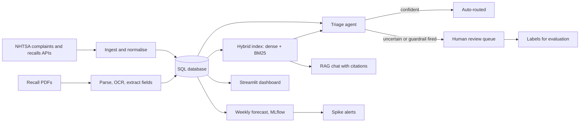

# Vehicle Service Intelligence Agent

Defect intelligence for vehicle quality and service teams, built on public NHTSA data. The system ingests
owner complaints and recall campaigns, triages each complaint with an LLM agent (component, severity,
linked recalls, calibrated confidence), sends uncertain cases to human review, answers questions with cited
sources, and forecasts weekly complaint volume per component with spike alerts.

**Live demo:** _link added after deploy_ (free; no sign-up; runs on a free-tier model).

## Try it in three minutes

1. **Try the agent** (the landing page): pick a real complaint and click **Run the agent**. You see the
   component, severity, linked recalls, the confidence against the routing threshold, why it was auto-routed
   or sent to review, and NHTSA's own coding of the same complaint, which the model never sees.
2. Switch to **Write your own** and click **Prompt injection attempt**: the agent flags it and forces human
   review. Click **Personal details**: names, phone numbers, emails and VINs are redacted before any model
   sees the text.
3. **Ask the data**: ask about defects or recalls; answers cite complaint and recall IDs, and citations the
   sources do not support are removed. Off-topic questions are refused.
4. **Human review**: approve or correct the cases the agent was unsure about; decisions become labels.
5. **Trends and spikes** and **Evaluation and cost**: the forecasts and the measured quality of each model.

The sidebar switches the AI model: the shared free Gemini key, your own key (Gemini and Groq have free
tiers), or an offline classifier that needs no AI at all.

## How it works



The triage agent is a fixed workflow, not a free-running loop (ADR-0060):

1. redact PII;
2. check for prompt injection;
3. call two tools (recall lookup by vehicle, hybrid recall search);
4. make one structured-output LLM call;
5. validate taxonomy and citations (the model can only cite recalls the tools returned for that vehicle,
   with an overlapping component);
6. apply a severity business rule (an owner-reported crash, fire, injury or death is always S1);
7. compute a calibrated confidence and route.

Any model failure falls back to the baseline classifier and to human review.

Models are switchable by config: local Ollama `qwen2.5:3b`, Gemini and Groq free tiers, Claude and OpenAI
(ADR-0006, ADR-0088). n8n orchestrates the scheduled jobs on the VM design (ADR-0001); Terraform and Docker
Compose describe that deployment.

## Results (measured)

All numbers come from scripts in this repo; labels are silver labels derived from NHTSA's own coding (see
the [gold-set datasheet](docs/data/datasheet-gold-set.md)).

| What | Result | Source |
|---|---|---|
| Corpus | 10,303 complaints (2022-01-02 to 2026-10-15, 8 makes), 407 recall rows (200 campaigns), 150 recall PDFs | `vsia ingest`, `vsia.documents` |
| Baseline classifier, gold split (200) | primary accuracy 0.555, any-label 0.680, macro-F1 0.578 | [report](docs/evaluation/reports/2026-10-19-heuristic-gold.md) |
| Baseline routing | 19% auto-routed at 0.895 accuracy (threshold 0.825) | same |
| Recall retrieval | recall@5 0.813 on 75 complaints with a known recall | same |
| Forecast, 12-week holdout | Poisson GLM champion, WAPE 50.33% vs 65.95% for seasonal naive | [backtest](docs/models/backtest-report.md) |
| Spike alerts | 18 alerts; 6 of 18 within 28 days of a recall vs a 0.304 base rate, so alerts flag volume, not recalls | same |
| PII | 94 matches in 75 of 10,303 complaints (0.73%), redacted before any model, index or log | [PII handling](docs/security/pii-handling.md) |
| LLM triage, local `qwen2.5:3b`, gold split (200) | primary accuracy 0.405 (below the baseline); calibrated routing auto-routes 27.5% at 0.964 accuracy (threshold 0.775); recall citations hit a known recall in 38.7% of cases; median 33 s per complaint on a laptop | [comparison](docs/evaluation/model-comparison.md), [report](docs/evaluation/reports/2026-10-19-ollama-gold.md) |
| LLM triage, Gemini free tier | being measured | `python -m eval.run_eval all --provider gemini` |

## Run it locally

Requirements: Python 3.11, [uv](https://docs.astral.sh/uv/), [Ollama](https://ollama.com) for the local
model (optional: the offline classifier and free cloud keys also work).

```bash
uv venv && uv pip install -e ".[dev]" -r requirements-streamlit.txt
ollama pull qwen2.5:3b && ollama pull nomic-embed-text
cp .env.example .env                      # optional keys: GEMINI_API_KEY, GROQ_API_KEY, ...

vsia ingest                               # NHTSA complaints and recalls into data/vsia.db
python -m vsia.documents                  # parse recall PDFs
python scripts/build_index.py --namespaces recalls recall_docs complaints
python -m vsia.classifier                 # baseline classifier
python -m pipelines.forecast all          # forecasts, MLflow registry, spike alerts

streamlit run app/streamlit_app.py        # dashboard at http://localhost:8501
uvicorn vsia.api:app --port 8000          # API, try it at http://localhost:8000/docs
vsia triage --limit 20                    # batch triage from the command line
```

Hosting the free public demo: [hosted-demo runbook](docs/operations/runbooks/hosted-demo.md).

## Documentation

| Topic | Documents |
|---|---|
| Design | [design doc](docs/design/design-doc.md) |
| Architecture | [C4 context](docs/architecture/c4-context.md), [containers](docs/architecture/c4-container.md), [triage components](docs/architecture/c4-component-triage.md), [sequences](docs/architecture/sequences.md), [data flow](docs/architecture/data-flow.md), [deployment](docs/architecture/deployment.md), [dashboard](docs/architecture/dashboard.md) |
| Decisions | [59 architecture decision records](docs/decisions/README.md) with options, trade-offs and revisit triggers |
| Data | [lineage](docs/data/lineage.md), [data dictionary](docs/data/data-dictionary.md), datasheets for the [corpus](docs/data/datasheet-nhtsa-corpus.md) and the [gold set](docs/data/datasheet-gold-set.md) |
| LLM | [tools](docs/llm/tools.md), prompts for [triage](docs/llm/prompts/triage.md), [RAG](docs/llm/prompts/rag.md), [recall extraction](docs/llm/prompts/recall-extraction.md) |
| Security and AI risk | [threat model (STRIDE)](docs/security/threat-model.md), [data-flow diagram](docs/security/data-flow-diagram.md), [AI risk register](docs/security/ai-risk-register.md), [guardrails](docs/security/guardrails.md), [PII handling](docs/security/pii-handling.md) |
| Evaluation | [eval plan](docs/evaluation/eval-plan.md), [metrics](docs/evaluation/metrics.md), [baseline classifier](docs/evaluation/baseline-classifier.md) |
| Models | [forecast backtest](docs/models/backtest-report.md), [forecaster model card](docs/models/model-card-forecaster.md) |
| Human in the loop | [review workflow](docs/hitl/review-workflow.md) |
| Operations | [SLOs](docs/operations/slos.md), [observability](docs/operations/observability.md), [cost model](docs/operations/cost-model.md), [incident playbook](docs/operations/incident-playbook.md), [runbooks](docs/operations/runbooks/) |

## What is verified and what is not

| Part | Status |
|---|---|
| Ingestion, PDF parsing, index, triage agent, RAG chat, forecasting, dashboard, API, guardrails | Built and run end to end on the laptop; 172 automated tests pass |
| Hosted demo path (bundle download, in-process embeddings, offline mode) | Rehearsed locally from a clean copy with no Ollama |
| Gemini and Groq calls | Covered by tests with mocked HTTP; live calls not yet run |
| n8n workflows, Open WebUI, Docker Compose, Terraform for the OCI VM | Written and statically validated; not yet executed (ADR-0008) |
| Gold labels | Silver labels from NHTSA fields; a hand-review sheet is in `data/gold/gold_set_review.csv` |

## Data and attribution

Complaint and recall data come from the U.S. National Highway Traffic Safety Administration public APIs
([nhtsa.gov](https://www.nhtsa.gov/)). Complaints are unverified owner reports. This project is not
affiliated with or endorsed by NHTSA.
