# C4 level 3: components of the triage agent

This view zooms into the VSIA API container and shows the components that triage one complaint. It is the
only component view in the documentation set: the triage agent is where most of the design decisions and
risks sit, and C4's guidance is to draw component views only where they add value
(`docs/research/01_documentation_process_research.md` section 3). The level above is the
[container view](c4-container.md); the runtime order of these components is in
[sequences.md](sequences.md#2-single-complaint-triage).

The triage agent is a **fixed workflow with tool calls, not a free-running agent loop** (ADR-0060): both
tools are called in code, the LLM is called once per complaint (plus at most one repair retry, ADR-0007),
and every step after the LLM call is deterministic.

## Diagram

```mermaid
flowchart TB
  subgraph callers["Callers"]
    apiep["API endpoints<br/>[Component: vsia.api]<br/>POST /triage, POST /triage/pending"]
    cli["CLI and evaluation<br/>[Component: vsia.cli, eval/run_eval.py]<br/>vsia triage, run_eval predict"]
  end

  subgraph agentbox["Triage agent [Container: VSIA API]"]
    wf["Triage workflow<br/>[Component: vsia.agent.triage]<br/>Fixed step order, signals dict, route"]
    guard["Guardrails<br/>[Component: vsia.guardrails]<br/>redact, detect_injection,<br/>wrap_untrusted, validate_citations"]
    lookup["Recall lookup tool<br/>[Component: vsia.tools.recall_lookup]<br/>All recalls for make, model family, year"]
    search["Recall search tool<br/>[Component: vsia.tools.recall_search]<br/>Hybrid search, vehicle-filtered,<br/>one hit per campaign"]
    retr["Retrieval<br/>[Component: vsia.retrieval]<br/>LocalStore dense + BM25 + RRF,<br/>or PineconeStore"]
    prompt["Prompt builder<br/>[Component: vsia.agent.system_prompt, _user_message]<br/>triage_v1.md + glossary + rubric"]
    clf["Baseline classifier<br/>[Component: vsia.classifier]<br/>TF-IDF + logistic regression,<br/>independent confidence signal"]
    gw["LLM gateway<br/>[Component: vsia.llm.complete_json]<br/>Schema-constrained call, Pydantic<br/>re-validation, one repair retry"]
    val["Semantic validation<br/>[Component: vsia.agent + vsia.taxonomy]<br/>Taxonomy normalisation, citation<br/>grounding, component overlap"]
    sev["Severity rule<br/>[Component: vsia.agent]<br/>Crash, fire, injury or death forces S1"]
    conf["Confidence scorer<br/>[Component: vsia.confidence.score]<br/>Per-provider calibrator or fallback blend"]
    route["Router<br/>[Component: vsia.agent + vsia.config]<br/>auto if confidence at or above threshold<br/>and no hard reason, else review"]
    persist["Persistence<br/>[Component: vsia.agent.save]<br/>triage_records, review_queue"]
  end

  cfg[("Configuration<br/>[config/settings.yaml, component_glossary.yaml]")]
  models[("Model files<br/>[data/models/: classifier, calibrator, routing_provider.json]")]
  db[("Operational database<br/>[complaints, recalls, triage_records,<br/>review_queue, llm_calls]")]
  idx[("Vector index<br/>[data/index/ or Pinecone]")]
  prov["LLM provider<br/>[External: Ollama, Anthropic, OpenAI,<br/>Gemini, Groq]"]
  nhtsa["NHTSA recalls API<br/>[External, only when live=True]"]

  apiep --> wf
  cli --> wf
  wf -->|"1 redact, score injection"| guard
  wf -->|"2 tools"| lookup
  wf -->|"2 tools"| search
  lookup -->|"SELECT recalls"| db
  lookup -.->|"optional live merge"| nhtsa
  search --> retr
  retr --> idx
  wf -->|"3 classifier probabilities"| clf
  clf --> models
  wf -->|"4 build messages"| prompt
  prompt --> cfg
  wf -->|"5 one structured call"| gw
  gw --> prov
  gw -->|"log metadata"| db
  wf -->|"6 validate"| val
  val --> guard
  wf -->|"7 apply rule"| sev
  wf -->|"8 score"| conf
  conf --> models
  wf -->|"9 route"| route
  route --> models
  route --> cfg
  wf -->|"10 persist"| persist
  persist --> db
```

## Elements

| Name | Responsibility | Technology | Code | ADR |
|---|---|---|---|---|
| API endpoints | `POST /triage` triages one complaint by ODI number or by an inline `Complaint` body; `POST /triage/pending` triages up to `limit` complaints that have no triage record yet, newest first, under one `batch-` run id | FastAPI | `src/vsia/api.py` | ADR-0001 |
| CLI and evaluation | `vsia triage` (one ODI or newest untriaged); `eval/run_eval.py predict` calls `triage(..., persist=True, enqueue=False)` with an `eval-` run id | argparse, Python | `src/vsia/cli.py`, `eval/run_eval.py` | ADR-0064 |
| Triage workflow | Runs the fixed sequence, collects every signal into `confidence_signals`, falls back to the classifier output if the LLM fails twice, builds the `TriageRecord` | Python | `src/vsia/agent.py` `triage()` | ADR-0060 |
| Guardrails | Regex PII redaction (email, card, full VIN keeping the 11-character prefix, phone, address, plate, name) before text reaches the LLM, embeddings or logs; heuristic injection score (noisy-OR, flag at 0.5); spotlighting with `<complaint>` tags; citation grounding against allowed ids | Standard library regex | `src/vsia/guardrails.py` | ADR-0063 (citations); redaction decisions referenced as 0020 and 0022 in code are not yet written |
| Recall lookup tool | Reads every recall for the vehicle from the local `recalls` table (reproducible), matching on make, model year and normalised model family; `live=True` also merges the NHTSA API (not used by the agent) | SQLAlchemy Core, httpx | `src/vsia/tools.py` `recall_lookup` | ADR-0004, ADR-0060 |
| Recall search tool | Searches the `recalls` and `recall_docs` namespaces with the redacted complaint text and a `vehicle_keys` filter, fuses at campaign level with RRF, returns at most `top_k` (5) campaigns; returns an empty list on any error | Python | `src/vsia/tools.py` `recall_search`, `src/vsia/retrieval.py` `search_recalls_for_complaint` | ADR-0030, ADR-0033 |
| Retrieval | `VectorStore` protocol; `LocalStore` (Ollama `nomic-embed-text` 768-d with task prefixes, BM25, RRF k = 60) or `PineconeStore` (`llama-text-embed-v2`, dense) | numpy, rank_bm25, Pinecone SDK | `src/vsia/retrieval.py` | ADR-0030 |
| Prompt builder | System prompt from `prompts/triage_v1.md` with the 24-label component glossary and the S1 to S4 rubric; user message with the vehicle on file, the redacted complaint wrapped in `<complaint>` and up to 12 candidate recalls in `<candidate_recalls>`. Never includes `components_raw` or `component_primary` | Python string templates, YAML | `src/vsia/agent.py`, `src/vsia/prompts/triage_v1.md`, `config/component_glossary.yaml` | ADR-0005, ADR-0060 |
| Baseline classifier | Probability per component from the redacted text; supplies `clf_prob_of_llm_label`, `clf_max_prob`, `clf_top_label` and `agree`; is the whole model for provider `heuristic` and the fallback after an LLM failure | scikit-learn TF-IDF (word 1-2, char 3-5) into class-balanced logistic regression | `src/vsia/classifier.py` | ADR-0061 |
| LLM gateway | Provider-agnostic `complete_json` over Ollama (`qwen2.5:3b`), Anthropic (`claude-haiku-5-5`), OpenAI (`gpt-6-luna`), Gemini (`gemini-2.5-flash-lite`, free tier) and Groq (`openai/gpt-oss-20b`, free tier); Gemini and Groq are called through their OpenAI-compatible Chat Completions endpoints with a strict JSON schema. Cleaned JSON schema per provider, Pydantic re-validation, one repair retry with the validator message, transport retries on 408/409/429/5xx, cost from the dated price table, one `llm_calls` row per call with no prompt text | httpx, tenacity, Pydantic | `src/vsia/llm.py`, `config/settings.yaml` `llm.providers` | ADR-0002, ADR-0006, ADR-0007, ADR-0088 |
| Semantic validation | Normalises an off-taxonomy component (`POWER TRAIN:DRIVELINE:...` to `POWER TRAIN`), de-duplicates secondary components (max 2), keeps only cited campaigns present in the candidate list, then only those sharing a component with the triage result; counts drops in `citations_dropped` | Python | `src/vsia/agent.py`, `src/vsia/taxonomy.py` | ADR-0007, ADR-0063 |
| Severity rule | Sets S1 when the complaint's crash or fire flag is set or injuries or deaths are above zero; keeps the model's value in `llm_severity` and marks `severity_rule_override` | Python | `src/vsia/agent.py` | ADR-0062 |
| Confidence scorer | Logistic-regression calibrator per provider over six signals (`llm_confidence`, `clf_prob_of_llm_label`, `clf_max_prob`, `agree`, `retrieval_top_score`, `schema_retry`), fitted on the calibration split; until fitted, a fixed blend (0.25, 0.45, 0.30 weights, minus 0.10 after a schema retry) recorded as `fallback_weights` | scikit-learn, joblib | `src/vsia/confidence.py` | ADR-0061 |
| Router | Threshold from `VSIA_CONFIDENCE_THRESHOLD`, else `data/models/routing_<provider>.json`, else `routing.confidence_threshold` (0.70). Routes to `review` when confidence is below threshold, the injection score is at least 0.5 or the model set `injection_suspected`, or the LLM failed twice | Python | `src/vsia/agent.py`, `src/vsia/config.py` | ADR-0061 |
| Persistence | Inserts the `triage_records` row and, for `review` routes when enqueueing is allowed, a `pending` `review_queue` row with the joined reasons, in one transaction | SQLAlchemy Core | `src/vsia/agent.py` `save()` | ADR-0003, ADR-0064 |

## Contracts at the component boundaries

| Boundary | Contract | Defined in |
|---|---|---|
| Caller to workflow | `Complaint` (Pydantic); `components_raw` is present on the object but never used in a prompt | `src/vsia/schemas.py` |
| Search tool to workflow | `RetrievalHit` list with `metadata.campaign_number`, `component`, `sources`, `best_dense_cosine` | `src/vsia/schemas.py`, `src/vsia/retrieval.py` |
| Gateway to workflow | `LLMResult(data: TriageOutput, call: LLMCall, raw_text, attempts)`; raises `LLMError` after a second invalid reply or a provider error | `src/vsia/llm.py` |
| LLM output | `TriageOutput`: extracted fields, component, up to 2 secondary components, severity and reason, up to 3 recall matches (campaign pattern `^\d{2}[VEITC]\d{6}$`), `model_confidence` in [0, 1], `injection_suspected` | `src/vsia/schemas.py` |
| Workflow to persistence | `TriageRecord` with `schema_version` `1.0`, `prompt_version` `triage-v1` | `src/vsia/schemas.py` |
| Tool specs for external agents | `RECALL_LOOKUP_SPEC`, `RECALL_SEARCH_SPEC` (name, description, JSON input schema) for n8n or MCP clients | `src/vsia/tools.py` |

## What is measured, and where

The quality of these components is reported by `eval/run_eval.py`: component accuracy (primary and
any-label), raw LLM S1 precision and recall (so the severity rule does not hide model quality, ADR-0062),
retrieval recall@5 separately from LLM match hit rate (ADR-0060, ADR-0063), auto-route rate and accuracy
(ADR-0061), failure rate, latency and cost per 1,000. Results: measured in docs/evaluation/ (pending).
