# C4 level 2: containers

This view zooms into the VSIA software system and shows its containers: separately running applications
and data stores, what each is responsible for and how they communicate. The level above is the
[system context](c4-context.md); the triage logic inside the API is broken down in the
[component view](c4-component-triage.md). Runtime order for the main use cases is in
[sequences.md](sequences.md). Where each container physically runs (laptop natively, Docker Compose on
the VM with networks, ports and memory limits, or the hosted demo on Streamlit Community Cloud) is in
[deployment.md](deployment.md), which this page does not repeat.

The central design rule (ADR-0001, ADR-0075): **the Python service owns all triage, RAG and forecasting
logic; n8n owns schedules, webhooks, retries and notifications and calls the service over HTTP.** The same
Python code runs behind the API, the CLI and the evaluation harness, so evaluation does not need n8n.

## Diagram

```mermaid
flowchart TB
  analyst["Analyst / manager<br/>[Person]"]
  teammate["Team member<br/>[Person]"]
  operator["Operator<br/>[Person]"]
  visitor["Demo visitor<br/>[Person]"]

  subgraph vsia["Vehicle Service Intelligence Agent [Software System]"]
    caddy["Reverse proxy<br/>[Container: Caddy 2]<br/>TLS termination, only public ports"]
    owui["Chat UI<br/>[Container: Open WebUI v0.12.3]<br/>vsia_pipe.py Pipe function"]
    n8n["Orchestrator<br/>[Container: n8n 2.43.7]<br/>Workflows 01 to 05: schedules,<br/>webhooks, retries, notifications"]
    api["VSIA API<br/>[Container: Python 3.11, FastAPI]<br/>Ingestion, triage agent, review,<br/>retrieval, RAG chat, forecast trigger"]
    jobs["Batch jobs and CLI<br/>[Container: Python 3.11 scripts]<br/>Document fetch and parse, index build,<br/>classifier training, gold set, evaluation"]
    dash["Dashboard<br/>[Container: Streamlit 1.66 + Plotly]<br/>Try the agent, Ask the data (agent and RAG in-process),<br/>overview, triage, review, trends, evaluation"]
    db[("Operational database<br/>[Container: Postgres 16 on VM, SQLite on laptop]<br/>11 tables in vsia.db")]
    mlflow["Experiment tracking<br/>[Container: MLflow 3.17.1]<br/>Runs, metrics, model registry"]
    files[("Data volume<br/>[Container: file system]<br/>PDFs, manifest, local index,<br/>gold set, models, eval predictions")]
  end

  nhtsa["NHTSA APIs<br/>[External System]"]
  llm["Anthropic / OpenAI<br/>[External System]"]
  ollama["Ollama<br/>[External System, local]"]
  pinecone["Pinecone<br/>[External System]"]
  notify["Notification webhook<br/>[External System]"]
  stcloud["Streamlit Community Cloud<br/>[External System]<br/>Runs the dashboard container for the hosted demo"]
  gemini["Google Gemini API<br/>[External System]<br/>Free tier, hosted demo"]
  groq["Groq API<br/>[External System]<br/>Free tier backup, hosted demo"]
  release["GitHub release asset<br/>[External System]<br/>Redacted demo data bundle"]

  teammate -->|"HTTPS"| caddy
  analyst -->|"HTTPS"| caddy
  visitor -->|"HTTPS, hosted demo"| stcloud
  stcloud -->|"Hosts"| dash
  operator -->|"CLI, SSH tunnel for MLflow"| jobs
  caddy -->|"chat host"| owui
  caddy -->|"n8n host"| n8n
  caddy -->|"api host"| api
  owui -->|"POST /webhook/vsia-chat, bearer"| n8n
  n8n -->|"HTTP JSON, bearer: /ingest/daily, /triage/pending,<br/>/review/*, /chat, /forecast/run, /search"| api
  n8n -->|"Workflow 05 only: INSERT triage_records"| db
  n8n -->|"Workflow 05 only"| llm
  n8n -->|"Run summaries, backlog, spike alerts"| notify
  api -->|"SQLAlchemy Core"| db
  api -->|"Tracking and registry, HTTP"| mlflow
  api -->|"Reads index, calibrator, routing files"| files
  api -->|"Complaints, recalls, HTTPS"| nhtsa
  api -->|"Structured output, HTTPS"| llm
  api -->|"LLM and embeddings, HTTP"| ollama
  api -->|"Search, HTTPS"| pinecone
  jobs -->|"SQLAlchemy Core"| db
  jobs -->|"Writes PDFs, index, gold, models, eval"| files
  jobs -->|"Recall document PDFs"| nhtsa
  jobs -->|"Embeddings, extraction fallback"| ollama
  jobs -->|"Upserts"| pinecone
  jobs -->|"Eval and forecast runs"| mlflow
  dash -->|"Live mode: SQLAlchemy reads, review writes"| db
  dash -->|"Hosted demo: structured output, HTTPS"| gemini
  dash -->|"Hosted demo: backup on 429"| groq
  dash -->|"First start: download, verify sha256"| release
  jobs -->|"Uploads bundle (build_demo_bundle.py)"| release
```

On the VM, Postgres sits on an internal Docker network with no egress; only Caddy publishes ports, and
MLflow is reachable through an SSH tunnel (ADR-0083). On Streamlit Community Cloud the dashboard container
is the whole hosted demo (ADR-0089): it downloads the redacted data bundle from a GitHub release asset on
first start (ADR-0091), runs the triage agent and RAG chat in-process against a shared, ephemeral SQLite
database, embeds queries in-process (ADR-0090) and calls a free-tier model (ADR-0088). The parquet
snapshot committed to the repository (ADR-0072) is the fallback when no bundle is configured.

## Elements

| Name | Responsibility | Technology | Code | ADR |
|---|---|---|---|---|
| Reverse proxy | Terminates TLS with automatic Let's Encrypt certificates for the chat, n8n and API host names; the only container with public ports (80, 443) | Caddy 2 (`caddy:2-alpine`), sslip.io names when there is no domain | `infra/compose/Caddyfile` | ADR-0082, ADR-0083 |
| Chat UI | Chat front end; the Pipe function extracts the latest user message, posts it to the n8n chat webhook, renders the answer with a numbered Sources list and emits `source` events; never raises into the chat | Open WebUI v0.12.3, Python Pipe | `openwebui/vsia_pipe.py` | ADR-0076, ADR-0077 |
| Orchestrator | Daily ingest then triage (01), hourly review backlog digest and review decision webhook (02), weekly forecast and alert (03), chat webhook (04), n8n-native agent variant, inactive by default (05). Thin HTTP clients with `retryOnFail` and error branches | n8n Community Edition 2.43.7, Postgres-backed | `workflows/n8n/*.json`, `scripts/validate_n8n.py` | ADR-0001, ADR-0075, ADR-0077, ADR-0078 |
| VSIA API | HTTP surface for every online operation: health, triage one or a batch, daily ingestion, review queue and decisions, retrieval as a tool, RAG chat, forecast retrain and spike detection. Optional bearer token (`VSIA_API_TOKEN`) | FastAPI, uvicorn, SQLAlchemy Core, httpx, Pydantic | `src/vsia/api.py` and the `vsia` package | ADR-0001, ADR-0002, ADR-0060, ADR-0065 |
| Batch jobs and CLI | Offline and scheduled-by-hand stages: `vsia ingest/triage/chat/review/serve`, `scripts/fetch_recall_docs.py`, `python -m vsia.documents`, `scripts/build_index.py`, `python -m vsia.classifier train`, `eval/build_gold.py`, `python -m eval.run_eval`, `python -m pipelines.forecast`, `scripts/export_demo_snapshot.py` | Python 3.11 in `.venv` (laptop) or the API image (VM) | `src/vsia/cli.py`, `scripts/`, `eval/`, `pipelines/` | ADR-0008, ADR-0031, ADR-0032, ADR-0033 |
| Dashboard | Operations, review and evaluation view; the only UI that writes review decisions (through `vsia.review.decide`); 5-minute cached narrow reads; demo mode from parquet. In the hosted demo it also runs `vsia.agent.triage()` ("Try the agent") and `vsia.rag.answer()` ("Ask the data") in-process, with an AI model picker and a quota guard | Streamlit 1.66, Plotly; fastembed for query embeddings in the hosted demo | `app/`, `app/hosted.py`, `src/vsia/bundle.py` | ADR-0071, ADR-0072, ADR-0073, ADR-0074, ADR-0089 to ADR-0092 |
| Operational database | System of record for complaints, recalls, documents, triage records, review queue, labels, LLM call log, ingestion runs, forecasts, spike alerts and eval runs | SQLite file `data/vsia.db` (laptop); Postgres 16, one instance with a database and role per service (VM) | `src/vsia/db.py`, `infra/compose/postgres-init.sql` | ADR-0003, ADR-0086 |
| Experiment tracking | Forecast experiment (`vsia-forecast`) with nested candidate runs, the registered model `vsia-complaint-forecaster` with alias `champion`; triage evaluation experiment (`vsia-triage-eval`) | MLflow 3.17.1, SQLite backend store, file artifact root on a shared volume | `pipelines/forecast.py`, `eval/run_eval.py` | ADR-0081 |
| Data volume | Raw PDFs and manifest, local vector index (`data/index/<namespace>/`), gold and calibration sets, classifier and calibrator models, routing thresholds, evaluation predictions | Local disk (`data/`) or the `vsia-data` Docker volume | `src/vsia/config.py` (`DATA_DIR`) | ADR-0002, ADR-0030 |
| Vector store (inside the API process or Pinecone) | Hybrid retrieval: Ollama embeddings plus BM25 fused with RRF in the local store; Pinecone integrated embedding (dense only) in the cloud. In the hosted demo the local store runs inside the Streamlit process and embeds queries with fastembed (`VSIA_EMBED_PROVIDER=fastembed`) | `vsia.retrieval.LocalStore` or `PineconeStore`, selected by `VSIA_VECTOR_STORE` | `src/vsia/retrieval.py` | ADR-0030, ADR-0033, ADR-0087, ADR-0090 |

External systems used only by the hosted demo:

| Name | Responsibility | Technology | ADR |
|---|---|---|---|
| Google Gemini API | Primary model for triage and chat on the owner's free key, or a visitor's key | `gemini-2.5-flash-lite` through the OpenAI-compatible Chat Completions endpoint (`vsia.llm._chat_completions`) | ADR-0088 |
| Groq API | Backup when Gemini answers 429 on the triage page, or a visitor's key | `openai/gpt-oss-20b`, same OpenAI-compatible caller | ADR-0088 |
| GitHub release asset | Holds the checksummed, redacted demo data bundle the app downloads on first start | `tar.gz` built by `scripts/build_demo_bundle.py` | ADR-0091 |
| Streamlit Community Cloud | Runs the dashboard container, deploys from the GitHub repository, holds the secrets | Free Community Cloud app | ADR-0089 |

## API surface between containers

The full endpoint table with request and response shapes is in the
[design doc](../design/design-doc.md#5-apis). The calls each caller makes:

| Caller | Endpoint | Purpose |
|---|---|---|
| n8n workflow 01 | `POST /ingest/daily`, then `POST /triage/pending` with `limit: 200` | Daily load and triage of new complaints |
| n8n workflow 02 | `GET /review/pending`; `POST /review/decision` | Backlog digest; forward a reviewer decision |
| n8n workflow 03 | `POST /forecast/run` | Weekly retrain (skipped when data is unchanged) and spike detection |
| n8n workflow 04 | `POST /chat` | RAG answer for the Open WebUI pipe |
| n8n workflow 05 | `GET /search` (tool), NHTSA recalls API (tool), Anthropic (model) | n8n-native agent comparison variant |
| Container healthchecks | `GET /health` | Liveness; reports provider, model, vector store and threshold |

## Container responsibilities not to blur

- **Logic stays in Python.** n8n Code nodes only shape counts and messages. The exception is workflow 05,
  which re-implements a subset of redaction in JavaScript and routes on the model's own confidence; its
  records are tagged `n8n-native-<execution>` and are not comparable to the calibrated Python path
  (ADR-0075, "Trade-offs accepted").
- **The dashboard does not call the API.** It reads the database directly (live) or parquet files (demo)
  and writes review decisions through `vsia.review.decide` in-process (ADR-0072, ADR-0073). In the hosted
  demo it calls the same Python functions the API wraps (`vsia.agent.triage`, `vsia.rag.answer`)
  in-process, so the logic still lives in the `vsia` package (ADR-0089).
- **Evaluation never enqueues review items** and tags its triage records with `eval-` run ids (ADR-0064).
