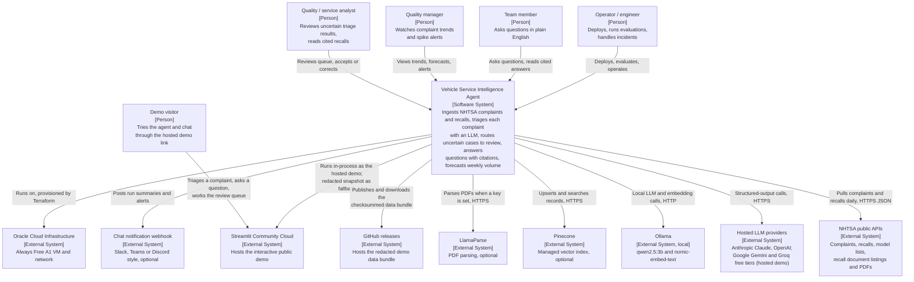

# C4 level 1: system context

This view shows the Vehicle Service Intelligence Agent (VSIA) as one box, the people who use it and the
external systems it depends on. It answers "what is this system and who or what does it talk to?" for a
non-technical reader. The next zoom level is the [container view](c4-container.md); the triage agent is
broken down further in the [component view](c4-component-triage.md). The physical placement of containers
on the laptop and the cloud VM is in [deployment.md](deployment.md).

Diagrams are drawn as Mermaid flowcharts with C4 labels rather than Mermaid's experimental `C4Context`
syntax, which renders inconsistently.

## Diagram

## Elements

| Name | Type | Responsibility | Technology | ADR |
|---|---|---|---|---|
| Quality / service analyst | Person | Works the human review queue: accepts or corrects component, severity and recall matches; corrections become labels | Streamlit review page, n8n review webhook | ADR-0073 |
| Quality manager | Person | Monitors complaint volume, forecasts and spike alerts | Streamlit dashboard | ADR-0071, ADR-0072 |
| Team member | Person | Asks plain-English questions about complaints and recalls; expects cited answers or a refusal | Open WebUI chat | ADR-0065, ADR-0076 |
| Operator / engineer | Person | Runs ingestion, indexing, evaluation and forecasting; deploys and operates the VM; follows runbooks | CLI, Terraform, Docker Compose, SSH | ADR-0008, ADR-0080, ADR-0085 |
| Demo visitor | Person | Opens the public link, runs the triage agent on a real or written complaint, asks cited questions, can paste their own API key | Streamlit hosted demo | ADR-0089, ADR-0092 |
| Vehicle Service Intelligence Agent | Software system | Defect intelligence for vehicle quality and service teams on public NHTSA data: ingest, extract, retrieve, triage with human review, chat with citations, forecast | Python 3.11 service and pipelines, n8n, Streamlit, Open WebUI, SQLite or Postgres | ADR-0001, ADR-0002 |
| NHTSA public APIs | External system | Source of complaints (`/complaints/complaintsByVehicle`), recalls (`/recalls/recallsByVehicle`), model strings (`/products/vehicle/models`) and recall document listings (`/safetyIssues/byNhtsaId`, unofficial) | HTTPS JSON, no key | ADR-0004 |
| Hosted LLM providers | External system | Triage, chat routing and answering, fallback document extraction on the VM; triage and chat in the hosted demo | Anthropic Messages API (`claude-haiku-5-5`), OpenAI Responses API (`gpt-6-luna`); Google Gemini (`gemini-2.5-flash-lite`) and Groq (`openai/gpt-oss-20b`) free tiers through their OpenAI-compatible endpoints | ADR-0006, ADR-0007, ADR-0088 |
| Ollama | External system (local) | Zero-key default LLM and the embedding model for the local vector store | `qwen2.5:3b`, `nomic-embed-text` (768-d) | ADR-0002, ADR-0006 |
| Pinecone | External system | Managed vector index for the cloud deployment (integrated embedding, dense only) | Pinecone serverless, `llama-text-embed-v2`, AWS us-east-1 | ADR-0030, ADR-0087 |
| LlamaParse | External system | Optional higher-fidelity PDF parsing when `LLAMA_CLOUD_API_KEY` is set; not used at build time | LlamaCloud API | ADR-0031 |
| Streamlit Community Cloud | External system | Hosts the interactive public demo: the Streamlit app runs the triage agent and RAG chat in-process on a shared, ephemeral SQLite database; the redacted parquet snapshot is the fallback | Streamlit, free Community Cloud app | ADR-0071, ADR-0072, ADR-0089 |
| GitHub releases | External system | Hosts the redacted demo data bundle (database, index, models) as a release asset; the app verifies its sha256 before unpacking | GitHub release asset, `tar.gz` | ADR-0091 |
| Chat notification webhook | External system | Receives ingestion summaries, review backlog and spike alert messages from n8n (nodes are disabled until a URL is set) | Incoming webhook, `{"text": ...}` body | ADR-0075 |
| Oracle Cloud Infrastructure | External system | Hosts the single VM and its network; provisioned with Terraform | OCI Always Free `VM.Standard.A1.Flex`, Terraform with local state | ADR-0080, ADR-0084 |

## Scope notes

- **Data boundary.** All data is public NHTSA data. Complaint narratives are still treated as containing
  personal data and as untrusted input: they are redacted before any LLM, embedding model or log line, and
  wrapped as data in prompts (see [threat model](../security/threat-model.md) and
  [data flow diagram](../security/data-flow-diagram.md)).
- **No downstream writes.** VSIA does not write to any external system of record. Its only outbound writes
  are LLM and embedding requests, Pinecone upserts, notification messages, the dashboard snapshot and the
  demo data bundle.
- **Laptop versus VM.** On the laptop, Ollama and the local vector store replace the hosted LLMs and
  Pinecone; n8n and Open WebUI are not run (ADR-0008). See [deployment.md](deployment.md) for the run
  modes.
- **Hosted demo.** On Streamlit Community Cloud the system runs inside the Streamlit app with no API, n8n
  or Open WebUI, on free-tier Gemini with Groq as backup, a visitor's own key or an offline classifier
  (ADR-0088 to ADR-0092).
