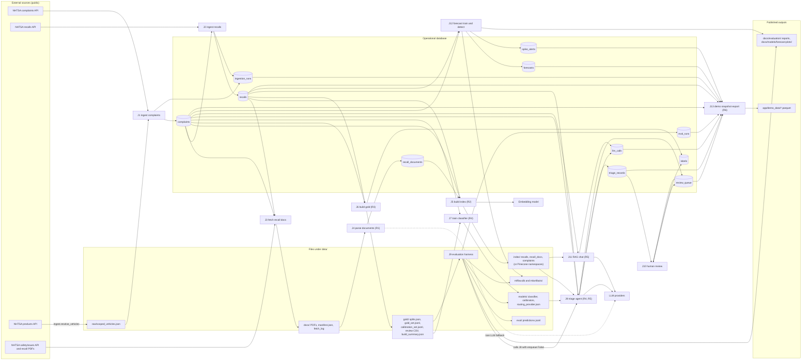

# Data flow

This page lists every dataset in VSIA (database tables, files and external indexes), the job that writes
it, the jobs that read it, and the exact points where PII redaction happens. Column-level detail is in the
[data dictionary](../data/data-dictionary.md); run-level tracing is in [lineage](../data/lineage.md). The
security view of the same flows, with trust boundaries, is in
[security/data-flow-diagram.md](../security/data-flow-diagram.md).

## Rules this page checks

1. **Redact before any model, embedding or log.** Complaint narratives and recall document text pass
   through `vsia.guardrails.redact()` before they reach an LLM, an embedding model, a vector index, a log
   field or a published file (AGENTS.md; ADR-0063 for the guardrail set).
2. **Label leakage.** `complaints.components_raw` and `complaints.component_primary` are NHTSA's own coding.
   They are ground truth for evaluation and training targets for the baseline classifier, and they are
   never LLM input for triage (ADR-0005).
3. **Evaluation isolation.** Evaluation predictions are stored in `triage_records` but never create
   `review_queue` rows (ADR-0064).

## Flowchart

Redaction points are marked `R1` to `R7`; they are listed in the table after the diagram.

`R7` (log redaction in `vsia.observability`) applies to every job that logs and is not drawn.

## Jobs

| Id | Job | Entry point | Trigger |
|---|---|---|---|
| J1 | Ingest complaints | `vsia.ingest.ingest_complaints` via `vsia ingest`, `POST /ingest/daily` | n8n workflow 01 daily 06:00, or manual |
| J2 | Ingest recalls | `vsia.ingest.ingest_recalls` | Same call as J1, after it |
| J3 | Fetch recall documents | `scripts/fetch_recall_docs.py` | Manual |
| J4 | Parse recall documents | `python -m vsia.documents` | Manual |
| J5 | Build vector index | `scripts/build_index.py` | Manual, after J2 or J4 |
| J6 | Build gold set and splits | `eval/build_gold.py` (uses `eval/splits.py`) | Manual, once per labelling version |
| J7 | Train baseline classifier | `python -m vsia.classifier train` | Manual |
| J8 | Triage agent | `vsia.agent.triage` via `POST /triage`, `POST /triage/pending`, `vsia triage` | n8n workflow 01 after new complaints, or manual |
| J9 | Evaluation harness | `eval/run_eval.py predict, calibrate, score, compare` | Manual |
| J10 | Human review | `vsia.review.decide` via dashboard review page or `POST /review/decision` | Analyst |
| J11 | RAG chat | `vsia.rag.answer` via `POST /chat` | Open WebUI through n8n workflow 04 |
| J12 | Forecast train and detect | `pipelines/forecast.py train, detect` via `POST /forecast/run` | n8n workflow 03 Monday 07:00, or manual |
| J13 | Demo snapshot export | `scripts/export_demo_snapshot.py` | Manual, before publishing the dashboard |
| J14 | Native n8n triage variant | `workflows/n8n/05_triage_agent_native.json` | Manual demo only (ADR-0075) |

## Datasets: writers, readers and redaction

Row counts are from `data/vsia.db` on 2026-10-19 (read-only query). Zero means the job has not run on
this database yet.

### Database tables

| Dataset | Rows | Written by | Read by | Text content and redaction |
|---|---|---|---|---|
| `complaints` | 10,303 | J1 (insert only, skip existing ODI) | J2 (vehicle list), J3 (campaign ranking), J5, J6, J7, J8, J11 (aggregate counts), J12, J13, dashboard | `summary` is the raw public NHTSA narrative and is stored **unredacted**; every consumer that passes it on redacts first (R2 to R6). `components_raw`, `component_primary`: never LLM input for triage |
| `recalls` | 407 (200 campaigns) | J2 (insert only, skip existing campaign x vehicle) | J3, J5, J6, J8 (`recall_lookup`), J12 (dates for the weak recall check), J13, dashboard | Public manufacturer recall text, no consumer PII; not redacted |
| `recall_documents` | 150 | J4 (delete then insert per `source_url`) | J4 (skip already parsed), J5 | `markdown` redacted before storage (R1) |
| `ingestion_runs` | 3 | J1, J2 | Dashboard, J13, operators | Counts and error strings only |
| `triage_records` | 0 | J8 (all callers, including J9 with `eval-` run ids), J14 (direct Postgres insert) | J8 (`/triage/pending` skips already triaged), J9 (scores the jsonl, not this table), J10, J13, dashboard | `output` holds model-extracted fields from redacted input; see the note on the heuristic path below |
| `review_queue` | 0 | J8 (when route is review and `enqueue` is true), J10 (status update) | J10, n8n workflow 02, J13, dashboard | `reason` holds rule names; redacted again on export (R6) |
| `labels` | 500 (all `gold_silver`) | J6 (`gold_silver`, `gold_hand` with `--promote`), J10 (`review`) | Calibrator refit on reviewed labels (planned, ADR-0061) | No narrative text; `note` is reviewer free text |
| `llm_calls` | 3 | `vsia.llm` gateway on every call (J4 fallback, J8, J9, J11, smoke test) | Dashboard cost view, J13 (aggregates only), [cost model](../operations/cost-model.md) | Metadata only, no prompt or reply text; `error` can contain a validator message (see open issue) |
| `forecasts` | 0 | J12 detect (delete then insert for the weeks it scores) | Dashboard trends, J13 | Numbers only |
| `spike_alerts` | 0 | J12 detect | API response to n8n workflow 03, dashboard, J13 | Numbers only |
| `eval_runs` | 0 | J9 score | Dashboard evaluation page, J13 | Metrics JSON only |

### Files and external stores

| Dataset | Written by | Read by | Text content and redaction |
|---|---|---|---|
| `data/raw/scoped_vehicles.json` | J1 (`resolve_vehicles`, first run; 145 entries) | J1, J2 | Vehicle strings only. `data/raw/nhtsa_model_strings.json` sits next to it but no current code writes or reads it |
| `data/docs/` PDFs, `manifest.json`, `fetch_log` | J3 | J4 | Raw PDFs contain sample owner names and company phone numbers; they never leave the data volume unparsed. `data/docs/`, `data/index/`, `data/models/`, `data/mlartifacts/` and `data/*.db` are git-ignored; `data/gold/` (redacted text) is not |
| `data/index/recalls/` | J5 | J8 (`recall_search`), J11, `GET /search` | Public recall text |
| `data/index/recall_docs/` | J5 | J8, J11, `GET /search` | Chunks of already-redacted markdown (R1) |
| `data/index/complaints/` | J5 (redacts each narrative, R2) | J11, `GET /search` | Redacted narrative only; no NHTSA component labels in text or metadata (ADR-0033) |
| Pinecone namespaces (VM) | J5 with `VSIA_VECTOR_STORE=pinecone` | Same as local index | Same text as local; the text leaves the VM to Pinecone, redacted |
| `data/gold/*` | J6 (redacts every summary into `summary_redacted`, R3) | J7, J9, dashboard evaluation page | Redacted narratives; silver labels (ADR-0005) |
| `data/models/component_clf.joblib`, `component_clf_metrics.json` | J7 | J8, J9 | Model weights trained on redacted text (R4) |
| `data/models/confidence_calibrator_<provider>.joblib`, `routing_<provider>.json` | J9 calibrate | J8 (`confidence.score`, `config.confidence_threshold`), J13 | Numbers only |
| `data/eval/*.jsonl` | J9 predict | J9 score, calibrate | Triage outputs |
| `data/mlflow.db`, `data/mlartifacts/` | J9 score, J12 train | J12 detect (champion), MLflow UI | Metrics, parameters, plots, model files |
| `docs/evaluation/reports/`, `model-comparison.md`, `baseline-classifier.md` | J9, J7 | Readers, dashboard | Aggregate metrics |
| `docs/models/forecast-plots/*.png` | J12 train | Readers | Plots |
| `app/demo_data/*.parquet`, `manifest.json` | J13 (redacts narratives and free text, R6) | Public Streamlit dashboard (ADR-0072) | Redacted narratives only for snapshot triage and review rows |

## Redaction points

| Id | Where | Code | What is redacted, and what reaches the next step |
|---|---|---|---|
| R1 | Recall document parsing, before storage | `src/vsia/documents.py` (`redact(md)` before the insert) | Owner-letter sample names, addresses and phone numbers; the redacted markdown is what the LLM fallback, the database and the index see |
| R2 | Index build, complaints namespace | `scripts/build_index.py` (`redact(c["summary"])`) | Each narrative before embedding and before it is stored in `meta.jsonl` or Pinecone |
| R3 | Gold set build | `eval/build_gold.py` (`summary_redacted`) | Narratives written to `data/gold/` and the review CSV |
| R4 | Classifier input | `src/vsia/classifier.py` `_redacted()` | Training and prediction text |
| R5 | Triage and search queries | `src/vsia/agent.py` (`guardrails.redact(c.summary)` first step), `src/vsia/retrieval.py` (query redaction in `search_recalls_for_complaint`, `search_complaints`, `search_sources`), `src/vsia/api.py` `GET /search` | Everything the triage LLM, classifier and embedding query see |
| R6 | Dashboard and demo snapshot | `app/data.py` (`complaint_text`, `redact_obj`), `scripts/export_demo_snapshot.py` | Narratives and free-text model output before display or publication |
| R7 | Structured logs | `src/vsia/observability.py` (string fields redacted before emission) | Log lines |

### Gaps in redaction coverage (not fixed in code)

- **RAG chat question.** `vsia.rag` redacts the retrieval query (through `retrieval.search_complaints`) but
  sends the user's question to the LLM wrapped with `wrap_untrusted` only, not redacted
  (`src/vsia/rag.py` lines 53 and 109). The question is typed by an internal user, not a consumer, but the
  rule in AGENTS.md covers any LLM input.
- **Heuristic provider symptom.** With provider `heuristic`, `src/vsia/agent.py` line 87 copies the first
  160 characters of the unredacted `c.summary` into `output.extracted.symptom`, which is stored in
  `triage_records.output`. The dashboard and the snapshot redact it again on read (R6), but the stored row
  is not redacted.
- **LLM call errors.** `src/vsia/llm.py` line 170 stores the Pydantic validation message in
  `llm_calls.error`; such messages can quote fragments of the model's reply.
- **Raw narratives at rest.** `complaints.summary` is stored unredacted by design (public source data,
  needed for re-redaction when the redactor improves). Access control for the database is the control; see
  the [threat model](../security/threat-model.md).
