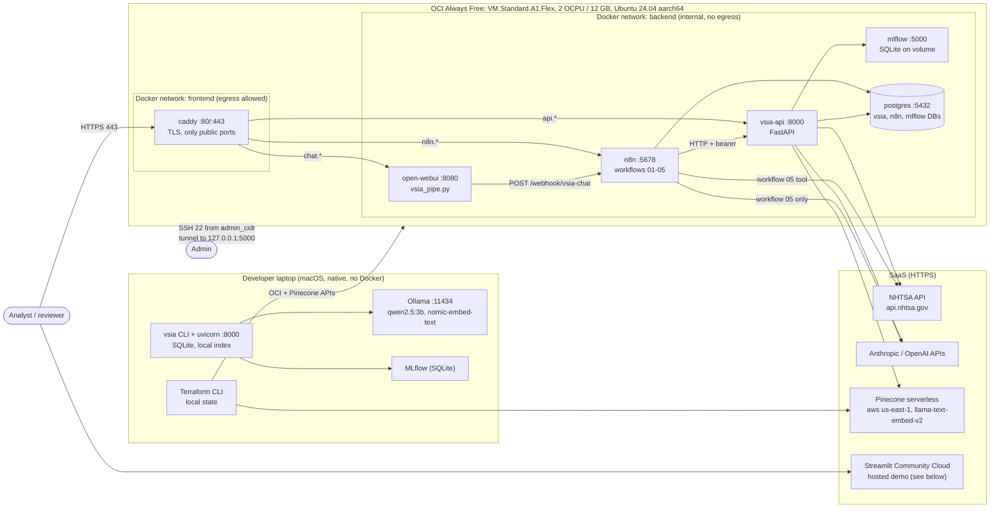
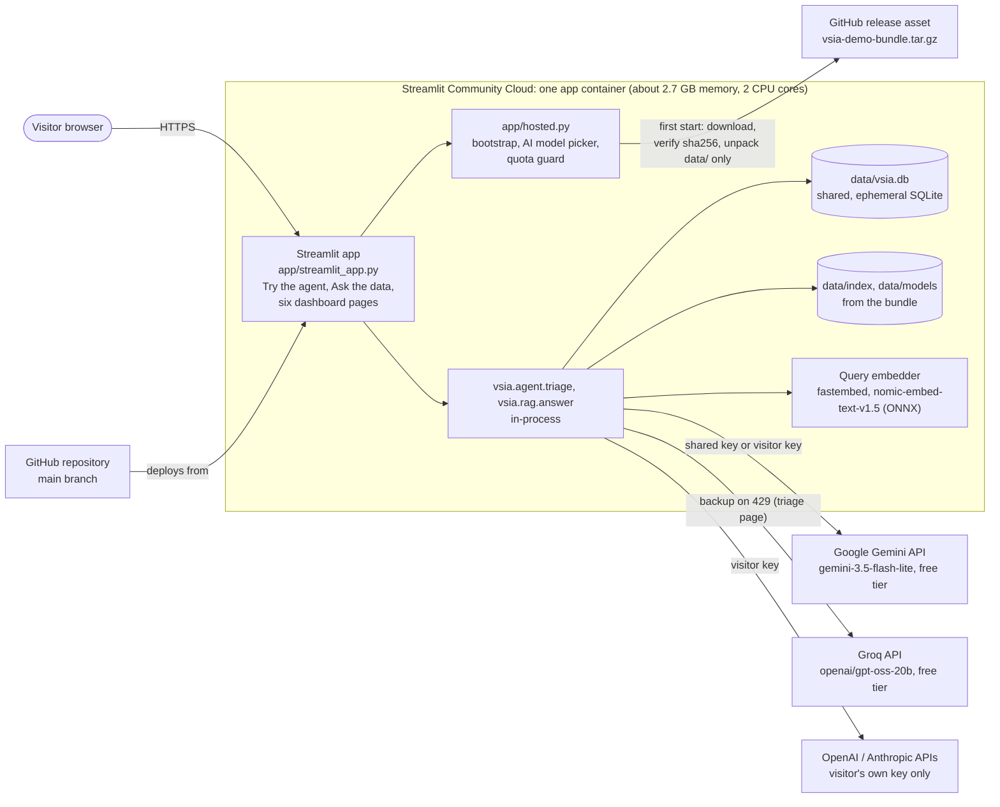

# Deployment view

This page describes where each part of VSIA runs, how the parts reach each other, how memory is
budgeted on the free VM, how secrets and backups are handled, and which parts have and have not been
exercised. Infrastructure code: `infra/compose/`, `infra/terraform/`, `Dockerfile`, `scripts/deploy_vm.sh`.

The OCI VM design below is unchanged. The shareable path is the free hosted demo on Streamlit Community
Cloud (ADR-0088 to ADR-0092), described in [Hosted demo](#hosted-demo-streamlit-community-cloud) at the end
of this page.

## Run modes

| Mode | Where | Database | LLM | Vector store | Orchestration | Chat UI |
|---|---|---|---|---|---|---|
| Laptop development (ADR-0008) | Native Python in `.venv` | SQLite `data/vsia.db` | Ollama `qwen2.5:3b` (default) or hosted APIs | Local index `data/index/` | CLI and `uvicorn vsia.api:app` | `vsia chat` CLI |
| OCI VM (this page) | Docker Compose on one Always Free A1 VM | Postgres 16 | Anthropic `claude-haiku-5-5` (or OpenAI) | Pinecone | n8n | Open WebUI |
| Hosted demo (ADR-0089) | Streamlit Community Cloud; the agent and RAG chat run in-process inside the Streamlit app | Shared, ephemeral SQLite `data/vsia.db` unpacked from the redacted demo bundle (ADR-0091) | Gemini `gemini-3.5-flash-lite` free tier, Groq `openai/gpt-oss-20b` backup, visitor's own key, or the offline classifier (ADR-0088) | Local index from the bundle; queries embedded in-process with fastembed (ADR-0090) | none | Streamlit "Ask the data" page |
| Dashboard snapshot (fallback) | Streamlit Community Cloud, or any host without a database | Reads the redacted parquet demo snapshot in `app/demo_data/` (ADR-0072); used when `VSIA_BUNDLE_URL` is unset or no database is reachable | n/a | n/a | n/a | Streamlit app, read-only |

## C4 deployment diagram



Services on both networks (n8n, vsia-api, open-webui, mlflow) are drawn in `backend` for readability;
they also join `frontend` for egress and for caddy to reach them. Postgres joins only `backend`.

## Ports

| Service | Container port | Published on host | Reachable from |
|---|---|---|---|
| caddy | 80, 443 | `0.0.0.0:80`, `0.0.0.0:443` | Internet (OCI security list allows 80, 443) |
| open-webui | 8080 | no | caddy (`CHAT_FQDN`) |
| n8n | 5678 | no | caddy (`N8N_FQDN`), open-webui |
| vsia-api | 8000 | no | caddy (`API_FQDN`), n8n |
| mlflow | 5000 | `127.0.0.1:5000` | SSH tunnel only: `ssh -L 5000:127.0.0.1:5000 ubuntu@<ip>` |
| postgres | 5432 | no | backend network only |
| SSH | 22 | host | `admin_cidr` only (security list) |

## Memory budget (12 GB VM)

Limits are set with `mem_limit` in `infra/compose/docker-compose.yml`. They are ceilings chosen from
each service's role, not measured peaks; measure with `docker stats --no-stream` after the first week.

| Container | `mem_limit` | Reasoning |
|---|---|---|
| postgres | 1 GiB | `shared_buffers=256MB`, `max_connections=60`; three small databases |
| n8n | 1.5 GiB | Node.js main process plus task runner for Code nodes |
| mlflow | 1 GiB | One server worker, SQLite backend; used weekly |
| vsia-api | 2 GiB | pandas, scikit-learn, MLflow model load during `/forecast/run`; no local models |
| open-webui | 2.5 GiB | Largest image; Python backend with its own embedding and RAG stack |
| caddy | 256 MiB | Reverse proxy and certificate store |
| **Total** | **8.25 GiB** | Leaves about 3.75 GB for the OS, Docker daemon and page cache, plus a 2 GB swap file from cloud-init |

Ollama is not run on the VM. A 1 to 3 billion parameter model would fit only by shrinking the other
limits, and the hosted APIs cost cents for this workload (research section 8.2).

## Secrets

| Secret | Lives in | Never in |
|---|---|---|
| Provider keys (Anthropic, OpenAI, Pinecone, LlamaParse) | `infra/compose/.env` on the VM (mode 600), laptop `.env` | Git, Terraform state, instance metadata, logs |
| `VSIA_API_TOKEN` | `.env`; n8n Header Auth credential | n8n expressions, Git, Streamlit secrets (the dashboard does not call the API) |
| `N8N_BEARER` (webhook auth) | n8n Header Auth credential; Open WebUI pipe valve | Git |
| `N8N_ENCRYPTION_KEY` | `.env` (must never change; back it up) | Git |
| Postgres passwords | `.env`; applied by `postgres-init.sql` on first start | Git |
| `PINECONE_API_KEY` for Terraform | shell environment during `terraform apply` | `terraform.tfvars`, state |
| OCI API signing key | `~/.oci/` on the laptop | the repository |

`.env` reaches the VM only through `scripts/deploy_vm.sh` over SSH (ADR-0085). The deploy script refuses to
run while `change-me` placeholders remain. Rotating a Postgres password after first start requires
`ALTER ROLE ... PASSWORD` inside Postgres as well as editing `.env`, because the init script runs once.

## Backups

Postgres holds the system of record (complaints, triage records, review decisions, labels, n8n
workflows and credentials).

```bash
# On the VM: nightly logical dump, kept 14 days (add to the ubuntu user's crontab).
cd /opt/vsia/infra/compose
docker compose exec -T postgres pg_dumpall -U postgres | gzip > ~/backups/pg-$(date +%F).sql.gz
find ~/backups -name 'pg-*.sql.gz' -mtime +14 -delete

# Copy off the VM from the laptop.
rsync -av ubuntu@<ip>:backups/ ./backups/

# Restore into an empty volume.
gunzip -c pg-YYYY-MM-DD.sql.gz | docker compose exec -T postgres psql -U postgres
```

Also back up: `infra/compose/.env` (in a password manager), `infra/terraform/terraform.tfstate`, and the
`mlflow-data` volume (`docker run --rm -v vsia_mlflow-data:/m -v $PWD:/b alpine tar czf /b/mlflow.tgz -C /m .`).
The Pinecone index can be rebuilt from Postgres, so it is not backed up. OCI Always Free includes five
block-volume backups; a boot-volume backup before upgrades is a cheap extra safety net.

## First deployment

1. `terraform apply` in `infra/terraform` (see its README; retry on "Out of host capacity").
2. Fill `infra/compose/.env` with secrets and the host names from `terraform output compose_hostnames`.
3. `scripts/deploy_vm.sh <public_ip>`: syncs the tree, copies `.env`, builds the API image on the VM,
   starts the stack.
4. Open `https://<CHAT_FQDN>` and `https://<N8N_FQDN>`, create the admin accounts immediately (the first
   account on each becomes the owner).
5. Import the n8n workflows and create credentials (`workflows/n8n/README.md`); install the Open WebUI
   pipe (`openwebui/README.md`).
6. Backfill data: `docker compose exec vsia-api vsia ingest`, then build the Pinecone index from the
   retrieval workstream's indexing command, then activate workflows 01 to 04.

## Verified vs not verified

Verified on the development laptop (2026-10-18):

- `docker compose -f infra/compose/docker-compose.yml --env-file infra/compose/.env.example config` exits
  0 (Docker Compose 2.39.2, no daemon used); without the env file it fails fast on missing secrets.
- `terraform fmt -check` passes for `infra/terraform` (Terraform 1.16.6).
- The Pinecone resource (`pinecone.tf`) passes `terraform validate` with provider `pinecone-io/pinecone`
  5.0.0 in an isolated copy that excludes the OCI resources.
- `python scripts/validate_n8n.py`: 5 workflows, 0 errors (2 warnings for the inferred
  `httpRequestTool` type); the validator was also shown to catch injected faults.
- `pytest tests/test_openwebui_pipe.py`: 9 tests pass with `httpx` mocked.
- `bash -n scripts/deploy_vm.sh` passes.

Not verified (nothing below has been run):

- No container has been built or started; the Docker image build, healthchecks and memory limits are
  untested (ADR-0008, disk constraint).
- `terraform validate` and `plan` for the OCI resources: the OCI provider (67 MB download, several hundred
  MB unpacked) was not downloaded. No OCI resource has been created.
- The image filter value `"Canonical Ubuntu"`, the need to open host iptables for 80/443, and whether
  Docker's published ports also need the host FORWARD chain opened on OCI images.
- n8n parameter shapes (Schedule cron rule, If conditions block, Postgres query parameters, `$fromAI` in
  tool parameters), the `n8n-nodes-base.httpRequestTool` type string and version, and import behaviour of
  placeholder credential ids.
- Whether n8n's `/healthz`, MLflow's `/health` and Open WebUI's `/health` endpoints behave as the
  healthchecks assume, whether MLflow 3.17's `--workers` flag and host-header checks accept requests from
  `vsia-api`, and whether the `caddy:2-alpine` and `postgres:16-alpine` tags (not in the research file)
  match current releases.
- The Open WebUI pipe inside a running Open WebUI, and end-to-end chat through n8n.

## Hosted demo (Streamlit Community Cloud)

The hosted demo is the free, shareable way to use VSIA: one link, no setup, zero cost to the owner. It does
not replace the VM design above. The Streamlit app runs the same `vsia` package in-process, so visitors can
triage a complaint, ask a question and work the review queue (ADR-0089). It refines ADR-0072: the public
app is live rather than a read-only snapshot, and the parquet snapshot is now the fallback when no bundle is
configured or no database is reachable. Deploy and operate it with
[the hosted demo runbook](../operations/runbooks/hosted-demo.md).



| Component | Where it runs | Secrets and settings | Notes |
|---|---|---|---|
| Streamlit app and pages | Community Cloud app container | none | Entrypoint `app/streamlit_app.py`; dependencies pinned in `app/requirements.txt` (a copy of `requirements-streamlit.txt`) |
| Bootstrap (`hosted.bootstrap`, `vsia.bundle.ensure`) | In the app process, on first start | `VSIA_BUNDLE_URL`, `VSIA_BUNDLE_SHA256` | Downloads the bundle when `data/vsia.db` and the bundle marker are missing; sets `VSIA_EMBED_PROVIDER=fastembed` (ADR-0091) |
| Triage agent and RAG chat | In the app process | Provider keys from secrets, or the visitor's key through `vsia.llm.use_keys()` | Same code as local development (ADR-0089) |
| AI model picker and quota guard (`app/hosted.py`) | In the app process | `VSIA_HOSTED_DAILY_LLM_CALLS` (default 400) | 15 AI calls per session on the shared key (`SESSION_AI_RUNS`); daily cap counted from `llm_calls` since midnight Pacific (ADR-0092) |
| Operational database | SQLite file inside the container | none | Shared by all visitors and reset when the app restarts; review writes are enabled because the runbook does not set `VSIA_READONLY` |
| Vector index, classifier, calibrators, routing files | `data/` inside the container | none | Unpacked from the bundle |
| Query embedder | In the app process | none | fastembed fp32 model (0.52 GB), downloaded on the first search after a cold start (ADR-0090) |
| Demo data bundle | GitHub release asset | Checksum held in `VSIA_BUNDLE_SHA256` | Redacted database, three index namespaces, classifier and routing files; first build 62,837,362 bytes (ADR-0091) |
| Google Gemini API | Google, OpenAI-compatible endpoint | `GEMINI_API_KEY`: the owner's free key, in a project with no billing account | Primary model (ADR-0088) |
| Groq API | Groq, OpenAI-compatible endpoint | `GROQ_API_KEY` (optional) | Backup when Gemini answers 429 on the triage page |
| Visitor's own key | That browser session's state only | none stored | Gemini, Groq, OpenAI or Anthropic; never written to the database, logs or `llm_calls` (ADR-0092) |

Not part of the hosted demo: the VSIA API, n8n, Open WebUI, the MLflow UI, Postgres and Pinecone. They stay
documented for the VM and run locally.

Measured and not measured:

- The bundle size and redaction count above come from the first build on 2026-10-19 (ADR-0091). The
  embedder parity table is in ADR-0090.
- The embedding model download took about 20 seconds measured locally on a home connection; on Community
  Cloud it is not yet measured.
- Memory use on Community Cloud, cold-start time and triage latency on the hosted app are not yet measured.
