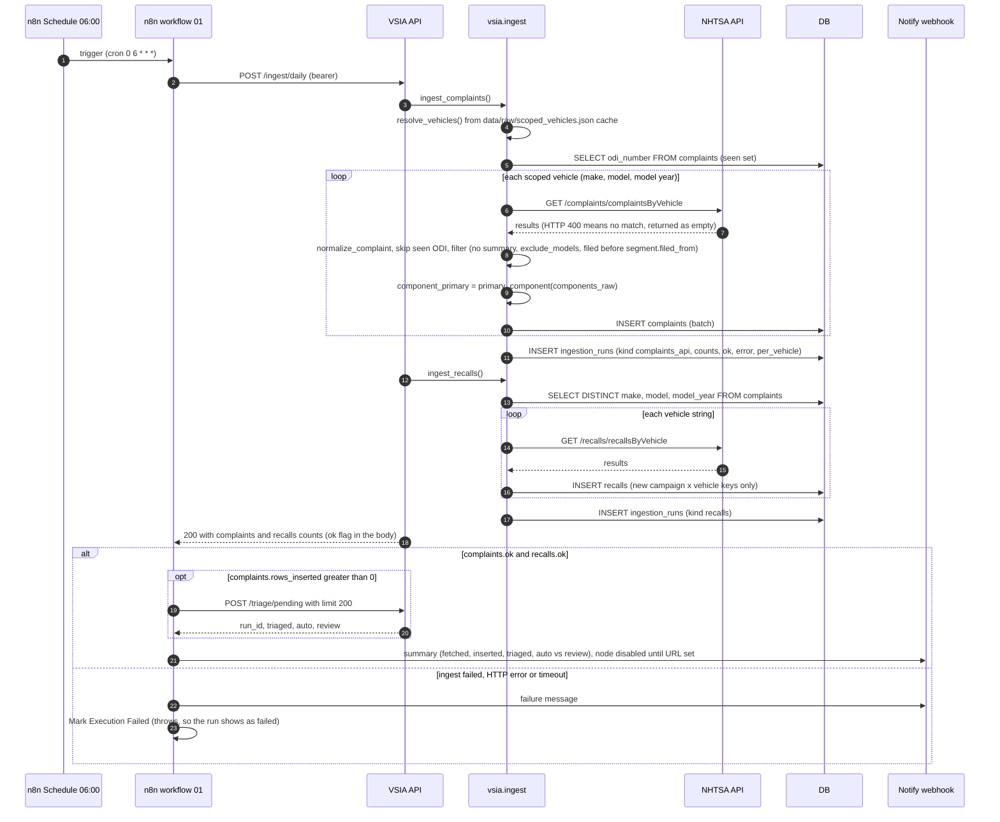
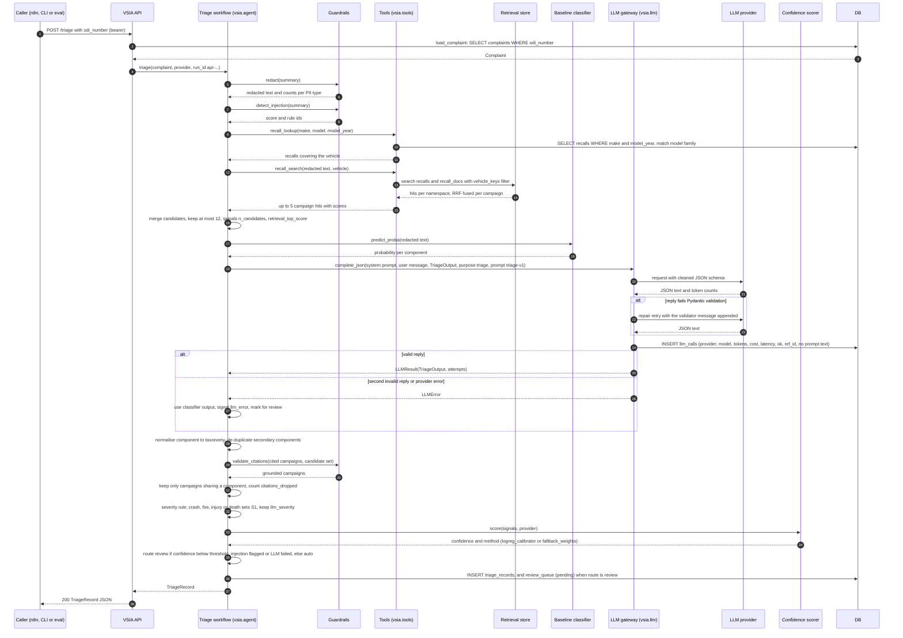
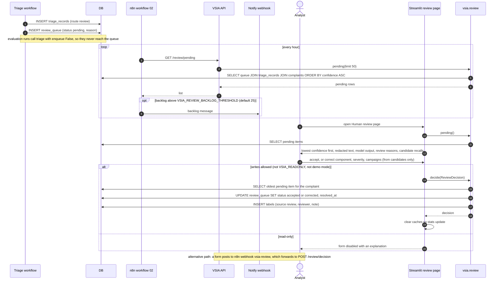
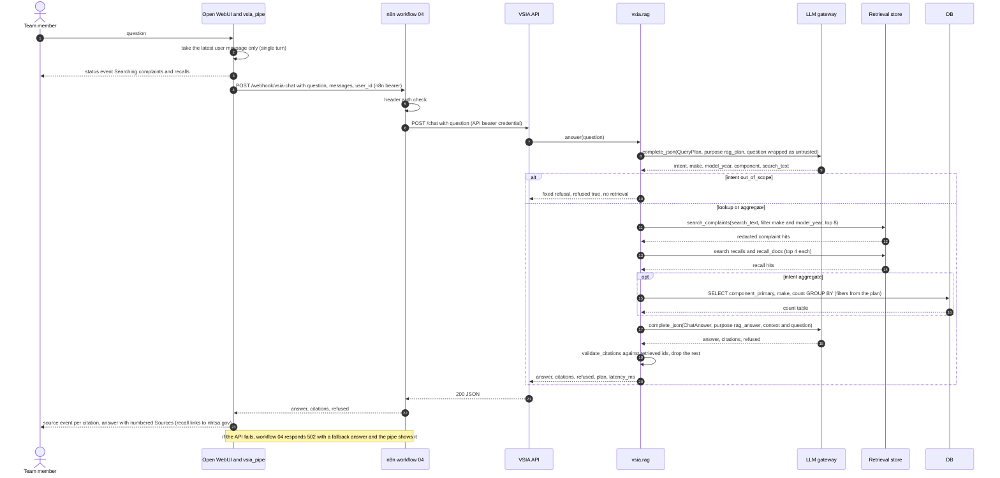
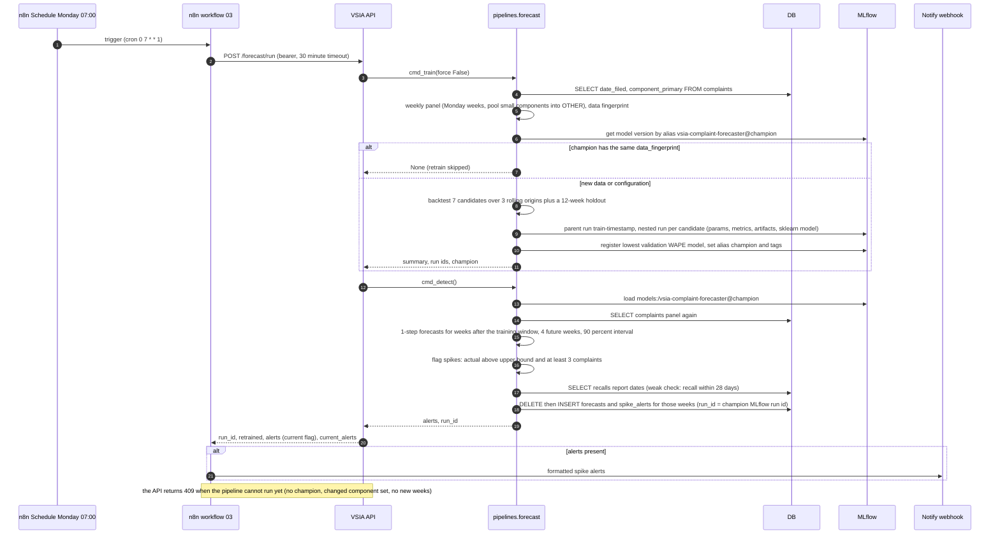
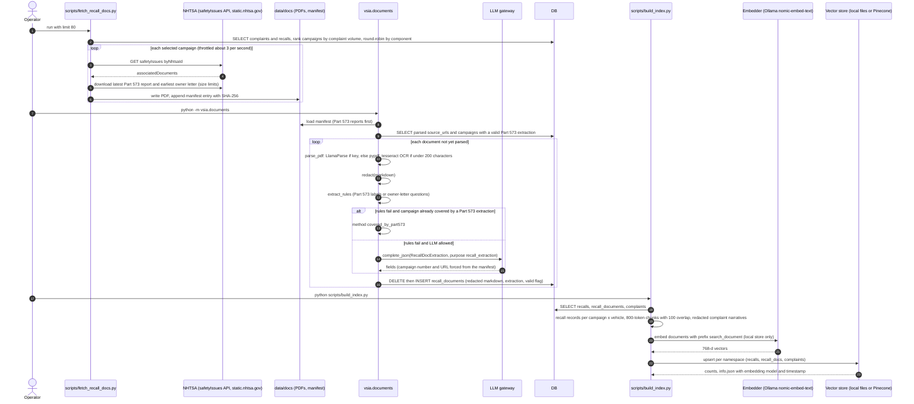

# Runtime sequences

These are C4 dynamic views: the runtime order of calls between containers and components for the six
main use cases. Static structure is in the [container view](c4-container.md) and the
[triage component view](c4-component-triage.md); data at rest is in the
[data dictionary](../data/data-dictionary.md). Each diagram names the real functions and endpoints in the
code so it can be checked against it.

1. [Daily ingestion via n8n](#1-daily-ingestion-via-n8n)
2. [Single complaint triage](#2-single-complaint-triage)
3. [Low-confidence routing to human review, and the decision becoming a label](#3-low-confidence-routing-to-human-review-and-the-decision-becoming-a-label)
4. [RAG chat through the Open WebUI pipe, n8n and the API](#4-rag-chat-through-the-open-webui-pipe-n8n-and-the-api)
5. [Weekly forecast and spike alert](#5-weekly-forecast-and-spike-alert)
6. [Recall document parsing and indexing](#6-recall-document-parsing-and-indexing)

Conventions: solid arrows are calls, dashed arrows are returns. "API" is the FastAPI service
(`src/vsia/api.py`); "DB" is SQLite on the laptop or Postgres on the VM (ADR-0003). n8n workflows have not
yet been executed in a running instance (ADR-0008, ADR-0078); the n8n parts below describe the exported
workflow JSON.

---

## 1. Daily ingestion via n8n

n8n workflow `01_daily_ingest_and_triage.json` (FR-1, FR-4; ADR-0001, ADR-0004, ADR-0075). The HTTP nodes
use 15-minute (ingest) and 30-minute (triage) timeouts, `retryOnFail` and an error output.

Notes:
- The API reports a failed complaint loop with `ok: false` inside an HTTP 200 body; workflow 01 checks the
  flag explicitly. A fetch error for one vehicle is logged and skipped, so `ok` stays true; only an error
  outside the per-vehicle loop sets it false. The recall run always records `ok: true` (see
  [lineage](../data/lineage.md#known-lineage-gaps)).
- Triage of the new rows is sequence 2, called once per complaint inside `POST /triage/pending`.
- Recovery steps are in [runbooks/ingestion-failed.md](../operations/runbooks/ingestion-failed.md).

---

## 2. Single complaint triage

`vsia.agent.triage()` as called by `POST /triage` (FR-4, FR-6; ADR-0060, ADR-0007, ADR-0061, ADR-0062,
ADR-0063). The same function runs for `POST /triage/pending`, `vsia triage` and the evaluation harness.

Notes:
- Redaction happens before any text reaches the classifier, the embedding model, the search query or the
  LLM. `components_raw` and `component_primary` are never in the prompt (ADR-0005).
- `recall_search` redacts the query again inside `search_recalls_for_complaint`; `redact` is idempotent.
- Latency is dominated by the single LLM call (ADR-0060). Measured values: measured in docs/evaluation/
  (pending).

---

## 3. Low-confidence routing to human review, and the decision becoming a label

FR-5; ADR-0061, ADR-0064, ADR-0073, ADR-0075. The human review operating procedure (queue service level,
audit sampling, label use) is in [hitl/review-workflow.md](../hitl/review-workflow.md).

Notes:
- The label row keeps the final component, severity and campaigns. An accepted item copies the triage
  record's values; a corrected item uses the reviewer's values.
- `labels` with `source = review` are the input for refitting the calibrator on reviewed labels
  (ADR-0061, "Revisit when"); that refit is not implemented yet.

---

## 4. RAG chat through the Open WebUI pipe, n8n and the API

FR-9; ADR-0065, ADR-0076, ADR-0077.

Notes:
- Each LLM call above writes one `llm_calls` row (`rag_plan`, `rag_answer`) with `prompt_version`
  `rag-v1` and no `ref_id`.
- The aggregate path counts NHTSA-coded `component_primary`. This is reference data shown to the chat model,
  not triage input, so it does not break the label-leakage rule for triage (ADR-0005), but the
  [threat model](../security/threat-model.md) should note it.

---

## 5. Weekly forecast and spike alert

FR-7; ADR-0081. n8n workflow `03_weekly_forecast_retrain.json` calls the API; the same code runs from the
CLI as `python -m pipelines.forecast all`.

Notes:
- The headline forecast metric is component-level WAPE on 1-step holdout forecasts; MAPE and the ratio to
  seasonal naive are also logged. Results: measured in docs/evaluation/ (pending); the MLflow store on the
  laptop holds one failed `train-20261019T054635Z` parent run and no registered champion at the time of
  writing.

---

## 6. Recall document parsing and indexing

FR-2, FR-3; ADR-0031, ADR-0032, ADR-0033, ADR-0030. These are operator-run batch jobs, not scheduled by n8n.

Notes:
- Measured at build time (ADR-0031, ADR-0032): 150 documents, 481 pages, 140 via pypdf and 10 via OCR, 799
  redactions; all 80 Part 573 reports extracted by rules, 8 of 70 owner letters by rules and 62 covered by
  their Part 573, 0 LLM calls.
- Index sizes (ADR-0033, `data/index/*/info.json`): recalls 407, recall_docs 352. The complaints
  namespace was being built at the time of writing.
- On Pinecone, embedding is done by the index (`llama-text-embed-v2`); vectors from the two stores are not
  comparable, so switching stores is a full re-index (ADR-0030).
