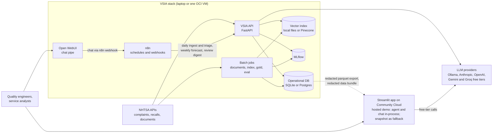

# Design doc: Vehicle Service Intelligence Agent (VSIA)

| | |
|---|---|
| Status | Implemented on the laptop; free hosted demo on Streamlit Community Cloud defined (ADR-0088 to ADR-0092); VM deployment defined but not yet exercised end to end |
| Author | Project author (AI workflow engineer) |
| Last updated | 2026-10-19 |
| Decision records | [docs/decisions/](../decisions/) (ADR-0001 to ADR-0092) |
| Requirements | The project PRD (FR-1 to FR-12); the PRD file is not in this repository, FR numbers are quoted below |

This is a Google-style design doc: context, goals, the design and its trade-offs, cross-cutting concerns
and the plan to roll it out. The architecture views it refers to are the C4
[context](../architecture/c4-context.md), [container](../architecture/c4-container.md) and
[triage component](../architecture/c4-component-triage.md) diagrams, the
[runtime sequences](../architecture/sequences.md) and the [data flow](../architecture/data-flow.md).

**Rule for numbers in this document.** Every number is either read from the code and configuration,
counted in `data/vsia.db`, or quoted from an ADR's measured "Consequences". Where a quality result does not
exist yet, the text says "measured in docs/evaluation/ (pending)".

---

## 1. Context and scope

Vehicle quality and service teams receive a steady stream of owner complaints. Each one must be read,
assigned to a component, judged for safety severity and checked against known recalls; across the stream,
the team needs to notice when complaints about one component start rising. This is defect intelligence,
and today it is mostly manual reading.

VSIA builds that capability on public data from the U.S. National Highway Traffic Safety Administration
(NHTSA): owner complaints, recall campaigns and recall documents. The current segment is electric and
hybrid SUVs and pickups from 8 makes (Ford, Tesla, Rivian, Hyundai, Kia, Chevrolet, Toyota, Volkswagen),
model years 2021 to 2026, complaints filed from 2022-01-01 (ADR-0004). The database holds 10,303
complaints, 407 recall rows for 200 campaigns and 150 parsed recall documents for 80 campaigns
([corpus datasheet](../data/datasheet-nhtsa-corpus.md)).

**In scope:** ingestion, document parsing, hybrid retrieval, an LLM triage agent with validation and
calibrated routing, a human review queue, retrieval-augmented chat, weekly complaint forecasting with spike
alerts, evaluation, a dashboard, orchestration with n8n and a single-VM deployment.

**Out of scope** (PRD non-goals): real customer or warranty data, real-time service levels, a polished
multi-user product, and fine-tuning models.

## 2. Goals and non-goals

### Goals

| Id | Goal | PRD target | Status |
|---|---|---|---|
| G1 | Daily, idempotent ingestion of complaints and recalls with run logging (FR-1) | Re-runs insert nothing new | Met: a re-run inserted 0 rows and skipped 13,367 duplicates (ADR-0004) |
| G2 | Parse recall PDFs to validated structured fields (FR-2) | At least 95% valid JSON | 88 of 150 documents carry a valid extraction; all 80 Part 573 reports are valid and 62 owner letters are covered by their campaign's Part 573 (ADR-0032). Whether "covered" counts toward FR-2 is an open question |
| G3 | Hybrid retrieval over recalls, recall documents and complaints (FR-3) | Top-5 in under 1 s; recall@5 at least 80% | Index built for recalls (407) and recall_docs (352) (ADR-0030, ADR-0033); recall@5 0.813 on the 75 gold complaints with a known recall ([model comparison](../evaluation/model-comparison.md)); latency not yet measured separately |
| G4 | Triage each complaint into extracted fields, component, severity and recall matches with citations (FR-4) | Component accuracy at least 85% | Not met: on silver labels, primary accuracy 0.535 for Gemini, 0.405 for `qwen2.5:3b` and 0.555 for the TF-IDF baseline; any-label 0.700, 0.520 and 0.680 ([model comparison](../evaluation/model-comparison.md)) |
| G5 | Route uncertain triage to a human and turn the decision into a label (FR-5) | At least 70% auto-routed | Not met: at about 0.90 accuracy the calibrated router auto-routes 44% (Gemini), 27.5% (`qwen2.5:3b`) and 19% (baseline) of gold complaints ([review workflow](../hitl/review-workflow.md)) |
| G6 | Switch LLM provider by configuration (FR-6) | Same code, any provider | Implemented for Ollama, Anthropic, OpenAI, Gemini, Groq and a no-LLM heuristic (ADR-0002, ADR-0088) |
| G7 | Weekly per-component forecast and spike alerts (FR-7) | Beat seasonal naive | Met on the backtest holdout: champion `glm_poisson` (`vsia-complaint-forecaster` v1) has 1-step WAPE 50.33 against 65.95 for the seasonal naive, a ratio of 0.763 ([backtest report](../models/backtest-report.md)) |
| G8 | Dashboard (FR-8) | Pages load in under 5 s | Cold load 1.6 s, warm 0.25 to 0.56 s on the demo snapshot (ADR-0074) |
| G9 | Chat over the corpus with citations (FR-9) | Grounded answers, refusals out of scope | Implemented (ADR-0065); quality measured in docs/evaluation/ (pending) |
| G10 | Infrastructure as code (FR-10) | One-command VM | Terraform, cloud-init and Compose defined (ADR-0080 to ADR-0087) |
| G11 | Guardrails (FR-11) | PII redaction, injection defence, grounded citations | Implemented in `vsia.guardrails`; 18 unit tests |
| G12 | Evaluation harness (FR-12) | Reproducible metrics per provider | Met: `eval/run_eval.py` scored three providers on the same 200 gold complaints ([model comparison](../evaluation/model-comparison.md)). Cost: $0 per 1,000 on the free tiers; about $1.35 per 1,000 at Gemini paid list prices ([cost model](../operations/cost-model.md)) |

### Non-goals

- Replacing engineering judgement about root cause. VSIA proposes; people decide on the review queue.
- Estimating defect rates or ranking makes. The corpus has no fleet-size denominators.
- Real-time processing. The pipeline is daily and weekly batch with synchronous API calls.
- Multi-tenant access control. One bearer token protects the API (ADR-0077).

## 3. Overview

The Python package `vsia` owns all logic; n8n only schedules, calls the API and notifies (ADR-0001). One
code path serves the laptop (SQLite, Ollama, local index) and the VM (Postgres, hosted LLM, Pinecone),
selected by environment variables (ADR-0002, ADR-0003, ADR-0030).

## 4. Detailed design

Each subsection names the code, the decision records and the main trade-off. Runtime order is in
[sequences.md](../architecture/sequences.md).

### 4.1 Ingestion (`src/vsia/nhtsa.py`, `src/vsia/ingest.py`)

- Resolves model strings at run time from `/products/vehicle/models` against regex patterns in
  `config/settings.yaml` and caches them (145 entries in `data/raw/scoped_vehicles.json`).
- Calls `complaintsByVehicle` per vehicle and `recallsByVehicle` per distinct complaint vehicle. HTTP 400
  is treated as "no match" and not retried; 429, 5xx and transport errors are retried (ADR-0004).
- Stores NHTSA's canonical model name from each complaint's product record. Derives `component_primary`
  from `components_raw` (ADR-0005).
- Idempotent: existing ODI numbers and recall keys are skipped; every run writes `ingestion_runs`.
- Trade-off: many small API calls instead of the 357 MB flat file; the backfill path is documented but not
  run (ADR-0004).

### 4.2 Recall document parsing (`scripts/fetch_recall_docs.py`, `src/vsia/documents.py`)

- Fetches the latest Part 573 report and the earliest owner letter per selected campaign from the
  unofficial safety-issues endpoint, with size caps and throttling.
- Parses with pypdf, falls back to tesseract OCR when a PDF yields under 200 characters, and uses
  LlamaParse only when a key is configured (ADR-0031). Measured: 150 documents, 481 pages, 140 via pypdf,
  10 via OCR, 799 redactions.
- Redacts the markdown before storage, then extracts fields with layout rules first and the LLM only as a
  fallback; an owner letter whose campaign already has a valid Part 573 extraction is marked
  `covered_by_part573` (ADR-0032). Measured: 88 rule extractions, 62 covered, 0 LLM calls.

### 4.3 Index and retrieval (`scripts/build_index.py`, `src/vsia/retrieval.py`)

- `VectorStore` interface with two implementations (ADR-0030):
  - `LocalStore`: Ollama `nomic-embed-text` (768 dimensions, task prefixes) plus BM25, fused by reciprocal
    rank fusion (k = 60). Files under `data/index/<namespace>/`.
  - `PineconeStore`: integrated `llama-text-embed-v2` embedding, dense only, on the VM.
- Namespaces (ADR-0033): `recalls` (one record per campaign and vehicle, 407), `recall_docs` (about
  800-token chunks with 100 overlap, 352), `complaints` (redacted narrative only; being built), `tsbs`
  reserved. Every record carries `vehicle_keys` `MAKE|MODELFAMILY|YEAR` for exact vehicle filtering.
- `search_recalls_for_complaint` searches recalls and recall documents with the vehicle filter and fuses
  at campaign level, so each campaign appears once.
- Measured build times: recalls 24 s, recall_docs 64 s (ADR-0030).

### 4.4 LLM gateway (`src/vsia/llm.py`)

- One function, `complete_json(system, user, output_model, purpose, prompt_version, ref_id)`, for every
  provider (ADR-0002). Models: `qwen2.5:3b` on Ollama, `claude-haiku-5-5` on Anthropic, `gpt-6-luna` on
  OpenAI, both hosted models priced at $0.10 input and $0.50 output per million tokens in
  `config/settings.yaml` (ADR-0006). Temperature 0, at most 700 output tokens.
- For the hosted demo, `gemini-3.5-flash-lite` on Google Gemini and `openai/gpt-oss-20b` on Groq, both on
  free tiers (price 0), go through one OpenAI-compatible caller (`_chat_completions`) with a strict,
  self-contained schema. `LLMError.status` carries the provider's HTTP status so callers can tell a 429
  from other failures. `use_keys()` supplies a visitor's own key for one request without storing or
  logging it (ADR-0088, ADR-0092).
- Sends a provider-specific cleaned JSON schema, re-validates the reply with Pydantic and retries once with
  the validator message (ADR-0007). Transport retries cover 408, 409, 429 and 5xx.
- Writes one `llm_calls` row per call with tokens, cost, latency, outcome, prompt version and business key;
  never the prompt or reply text.

### 4.5 Guardrails (`src/vsia/guardrails.py`)

- `redact()`: regex redaction of email, payment card, full VIN (keeping the 11-character prefix NHTSA
  publishes), phone (including vanity toll-free numbers), street address and PO box, licence plate, and
  names after titles, labels, introductions and sign-offs; idempotent.
- `detect_injection()`: rule-based score (noisy-OR over patterns), flagged at 0.5; flagged complaints are
  always routed to review.
- `wrap_untrusted()`: spotlighting; complaint text is wrapped in tags the system prompt declares as data.
- `validate_citations()`: keeps only ids present in the retrieved or candidate set (ADR-0063).

### 4.6 Triage agent (`src/vsia/agent.py`)

A fixed workflow, not a free-running agent loop (ADR-0060):

1. Redact and score injection.
2. Tools: `recall_lookup` (all recalls for the vehicle from the `recalls` table) and `recall_search`
   (hybrid search); candidates merged, at most 12.
3. Baseline classifier probabilities (`src/vsia/classifier.py`, TF-IDF and logistic regression on redacted
   text; ADR-0061 uses it as an independent signal).
4. One `complete_json` call returning `TriageOutput` (prompt `triage-v1`, `src/vsia/prompts/triage_v1.md`
   with the component glossary and severity rubric).
5. Validation: taxonomy normalisation, citation grounding, and component overlap between the triage
   result and each cited recall (ADR-0063).
6. Severity rule: crash, fire, injuries or deaths force S1; the model's own value is kept for evaluation
   (ADR-0062). 930 of 10,303 complaints carry such a flag.
7. Confidence and routing (4.7), then persistence.

Labels never enter the prompt: `components_raw` and `component_primary` are NHTSA's coding and serve only
as ground truth (ADR-0005). Provider `heuristic` replaces steps 4 to 5 with the classifier and costs
nothing; it is the fallback when no LLM is available.

### 4.7 Confidence and routing (`src/vsia/confidence.py`, `src/vsia/config.py`)

- Signals: model confidence, classifier probability of the model's label, classifier maximum
  probability, agreement, top retrieval score, schema retry.
- A logistic-regression calibrator per provider is fitted on the 300-complaint calibration split; the
  threshold is the lowest whose auto-routed accuracy reaches 0.90 and is written to
  `data/models/routing_<provider>.json` (ADR-0061).
- Until a calibrator exists, a fixed blend is used (0.25 model confidence, 0.45 classifier probability of
  the model's label, 0.30 agreement, minus 0.10 after a schema retry) with the configured threshold 0.70.
- Route `review` when confidence is below the threshold, injection is suspected, or the LLM failed.
- Current state: no calibrator or routing file has been fitted, so the fallback is in force.

### 4.8 Human review (`src/vsia/review.py`, `app/views/review.py`)

- `review_queue` rows are created only for production calls; evaluation passes `enqueue=False`
  (ADR-0064).
- Analysts work lowest confidence first in the dashboard's review page (ADR-0073), or through the n8n
  `vsia-review` webhook. Each decision updates the queue and inserts a `labels` row with
  `source = review`.
- n8n workflow 02 checks the backlog hourly and notifies above 25 items.
- Operating procedure: [hitl/review-workflow.md](../hitl/review-workflow.md).

### 4.9 RAG chat (`src/vsia/rag.py`, `openwebui/`, workflow 04)

- Router pattern (ADR-0065): one LLM call plans the query (`lookup`, `aggregate` or `out_of_scope`, with
  make, model year, component and search text); out-of-scope questions are refused without retrieval.
- Retrieval: complaints (top 8), recalls and recall documents (top 4 each); the aggregate intent adds a
  SQL count by component and make. A second call answers with citations, which are filtered against the
  retrieved ids. Prompt version `rag-v1`.
- Open WebUI's pipe forwards the latest user message to the n8n `vsia-chat` webhook, which calls
  `POST /chat`; responses are non-streaming, with a 120 s pipe timeout (ADR-0076). Webhooks use header
  authentication and API tokens live in n8n credentials (ADR-0077).

### 4.10 Forecasting (`pipelines/forecast.py`, `pipelines/features.py`)

- Weekly (Monday) complaint counts per `component_primary`; components with fewer than 30 complaints are
  pooled into `OTHER` (the 2026-10-19 panel: 249 weeks, 20 series, 4 components pooled).
- Candidates: naive, seasonal naive (52 weeks), moving averages (4 and 8), simple exponential smoothing,
  Poisson GLM and gradient boosting, compared over 3 rolling validation folds and a 12-week holdout.
  Headline metric: component-level WAPE of 1-step forecasts.
- The best scikit-learn model by validation WAPE is registered as `vsia-complaint-forecaster` with alias
  `champion` in MLflow (SQLite backend, ADR-0081). A data fingerprint makes an unchanged dataset skip
  retraining.
- Detection writes `forecasts` and `spike_alerts` (actual above the 90% upper bound and at least 3
  complaints) and reports alerts in the last 4 weeks and recalls within 28 days.
- Current state (2026-10-19): earlier training runs failed while logging a candidate model (skops
  serialization; fixed by ADR-0055). Run `train-20261019T182422Z` completed and registered `glm_poisson` as
  `vsia-complaint-forecaster` v1 `@champion` (run `98acce0d6c244ef9a75db49e2e9a1ea5`): holdout 1-step
  WAPE 50.33 against 65.95 for the seasonal naive (ratio 0.763). `detect` stored 320 forecast rows and 18
  spike alerts. Alerts are not early warnings of recalls: 6 of 18 were near a same-component recall against
  a base rate of 0.304 ([backtest report](../models/backtest-report.md), section 4).

### 4.11 Evaluation (`eval/build_gold.py`, `eval/splits.py`, `eval/run_eval.py`)

- Splits `splits-v1` (seed 42, random stratified): gold 200, calibration 300, train 9,803. Labels are
  silver (`silver-v1`): derived from NHTSA fields and rules, not hand labelled (ADR-0005;
  [gold set datasheet](../data/datasheet-gold-set.md)).
- `predict`, `calibrate`, `score`, `compare`; results go to `eval_runs`, MLflow experiment
  `vsia-triage-eval`, `docs/evaluation/reports/` and `docs/evaluation/model-comparison.md`.
- Plan and metric definitions: [eval-plan.md](../evaluation/eval-plan.md),
  [metrics.md](../evaluation/metrics.md). The baseline classifier report is
  [baseline-classifier.md](../evaluation/baseline-classifier.md). Triage results: measured in
  docs/evaluation/ (pending).

### 4.12 Orchestration (`workflows/n8n/`)

| Workflow | Trigger | Calls |
|---|---|---|
| 01 daily ingest and triage | Cron 06:00 | `POST /ingest/daily`, then `POST /triage/pending` (limit 200) when new complaints arrived; notify; mark failed on error |
| 02 review queue digest | Hourly; webhook `vsia-review` | `GET /review/pending`; `POST /review/decision` |
| 03 weekly forecast | Monday 07:00 | `POST /forecast/run`; notify on alerts |
| 04 RAG chat | Webhook `vsia-chat` | `POST /chat`; 502 with a fallback answer on error |
| 05 native triage agent | Manual | n8n AI agent with Anthropic, NHTSA recalls tool and `GET /search`; inserts `triage_records` directly (a demonstration variant, ADR-0075) |

Workflows are exported to git, inactive, and validated statically by `scripts/validate_n8n.py`
(ADR-0078).

### 4.13 Dashboard (`app/`)

Streamlit (ADR-0071) with "Try the agent" and "Ask the data" pages plus overview, triage, trends, review,
evaluation and about pages. The public deployment is the hosted demo on Streamlit Community Cloud: it runs
`vsia.agent.triage()` and `vsia.rag.answer()` in-process on a shared, ephemeral SQLite database downloaded
as a checksummed, redacted release asset, embeds queries in-process with fastembed, and calls free-tier
Gemini with Groq as backup, a visitor's own key or the offline classifier, under per-session and per-day
caps (ADR-0088 to ADR-0092, refining ADR-0072). The redacted parquet snapshot in `app/demo_data/` (152,565
bytes, exported 2026-10-19 06:12 UTC) is the fallback when no bundle is configured; caching follows
ADR-0074. Details: [architecture/dashboard.md](../architecture/dashboard.md).

### 4.14 Deployment (`infra/`, `docker-compose`)

One OCI Ampere A1 VM (2 OCPU, 12 GB) runs Postgres 16, n8n, MLflow, the VSIA API, Open WebUI and Caddy in
Docker Compose, with memory limits that sum to 8.25 GB (ADR-0080). Only Caddy is public, with TLS on sslip
host names (ADR-0082, ADR-0083); services sit on an internal backend network. Terraform with local state
(ADR-0084), cloud-init bootstrap with secrets copied over SSH (ADR-0085), one Postgres instance with a
database per service (ADR-0086), and the Pinecone index managed by Terraform (ADR-0087). The laptop runs
without Docker (ADR-0008). The shareable path is separate: the free hosted demo on Streamlit Community
Cloud (ADR-0089), which needs no VM. Details: [architecture/deployment.md](../architecture/deployment.md).

## 5. APIs

FastAPI service `src/vsia/api.py` (`uvicorn vsia.api:app --port 8000`). Every endpoint except `/health`
requires `Authorization: Bearer <VSIA_API_TOKEN>` when that variable is set; unset means local development
without authentication (ADR-0077).

| Method and path | Request | Response | Caller | Notes |
|---|---|---|---|---|
| `GET /health` | none | `ok`, `llm_provider`, `llm_model`, `vector_store`, `threshold` | Docker health check, probes | Runs `select 1` on the database; no auth |
| `POST /triage` | `odi_number` or an inline `complaint`, optional `provider` | `TriageRecord` | Operators, tests | Run id `api-...`; an unknown ODI raises `KeyError` (HTTP 500) |
| `POST /triage/pending` | `limit` (default 50), optional `provider` | `run_id`, `triaged`, `auto`, `review` | n8n workflow 01 (limit 200) | Complaints with no triage record of any kind, newest filed first; synchronous |
| `POST /ingest/daily` | none | `complaints` and `recalls` run summaries (counts, `ok`, `error`) | n8n workflow 01 | HTTP 200 even when `ok` is false |
| `GET /review/pending` | `limit` (default 50) | Pending items with model output, vehicle and narrative | n8n workflow 02 | Lowest confidence first. Returns the stored narrative; consumers must redact before display |
| `POST /review/decision` | `ReviewDecision` (`odi_number`, `accepted`, optional `component`, `severity`, `recall_campaigns`, `reviewer`, `note`) | Final label | n8n `vsia-review` webhook | 404 when nothing is pending for the complaint |
| `GET /search` | `q`, optional `namespace`, `make`, `model`, `model_year`, `top_k` (5) | `RetrievalHit` list | n8n workflow 05, debugging | With make, model and year and no namespace it runs the agent's recall search; otherwise a namespace search filtered by make and year (`model` is ignored on that path) |
| `POST /chat` | `question`, optional `provider` | `answer`, `citations`, `refused`, `plan`, `latency_ms` | n8n workflow 04 | Two LLM calls per answered question |
| `POST /forecast/run` | `force` (query, default false) | `run_id`, `retrained`, `alerts` (`component`, `week`, `actual`, `upper`, `ratio`, `current`), `current_alerts` | n8n workflow 03 | HTTP 409 when the pipeline cannot run yet (no champion, changed component set, no new weeks) |

Contracts are the Pydantic models in `src/vsia/schemas.py` (`Complaint`, `TriageOutput`, `TriageRecord`,
`ReviewDecision`, `RetrievalHit`, `ChatAnswer`, `RecallDocExtraction`). The tool specs
`RECALL_LOOKUP_SPEC` and `RECALL_SEARCH_SPEC` in `src/vsia/tools.py` describe the two tools for external
agent frameworks.

## 6. Data storage

One relational schema (`src/vsia/db.py`, SQLAlchemy Core, `create_all` without migrations) on SQLite or
Postgres (ADR-0003). Full column definitions: [data dictionary](../data/data-dictionary.md). Lineage:
[lineage.md](../data/lineage.md).

| Table | Purpose | Writer | Rows on 2026-10-19 |
|---|---|---|---|
| `complaints` | NHTSA owner complaints (raw narrative kept; redacted at use) | ingestion | 10,303 |
| `recalls` | Recall campaign x vehicle | ingestion | 407 |
| `recall_documents` | Parsed, redacted recall PDFs and extractions | document parsing | 150 |
| `ingestion_runs` | Run log with counts | ingestion | 3 |
| `triage_records` | Triage output, provenance, signals, route | triage agent, evaluation, workflow 05 | 0 |
| `review_queue` | Pending and resolved review items | triage agent, review | 0 |
| `labels` | Silver, hand and review labels | gold build, review | 500 |
| `llm_calls` | LLM call metadata and cost | LLM gateway | 3 |
| `forecasts` | Weekly forecasts with intervals | forecast detect | 0 |
| `spike_alerts` | Component-weeks above the interval | forecast detect | 0 |
| `eval_runs` | Scored evaluation runs | evaluation | 0 |

Other stores: vector index files or Pinecone namespaces, `data/gold/`, `data/models/`, `data/eval/`,
MLflow (`data/mlflow.db`, `data/mlartifacts/`) and the dashboard snapshot. Their writers and readers are in
[data-flow.md](../architecture/data-flow.md#files-and-external-stores).

## 7. Alternatives considered

Each decision has an ADR with the options and trade-offs. Summary of the main ones:

| Decision | Chosen | Main alternative rejected | ADR |
|---|---|---|---|
| Where logic lives | Python service; n8n orchestrates | Logic inside n8n nodes | [0001](../decisions/0001-python-service-owns-logic-n8n-orchestrates.md) |
| Provider strategy | Offline-first, provider abstraction | Single hosted provider | [0002](../decisions/0002-offline-first-provider-abstraction.md) |
| Database | SQLite locally, Postgres on the VM | Postgres everywhere | [0003](../decisions/0003-sqlite-local-postgres-on-vm.md) |
| Ingestion | API with runtime model discovery | Flat-file backfill, hard-coded strings | [0004](../decisions/0004-segment-scope-and-ingestion-strategy.md) |
| Taxonomy | NHTSA top-level components, labels never model input | Custom taxonomy, hand labels only | [0005](../decisions/0005-component-taxonomy-and-label-leakage.md) |
| Models | Small local model plus low-cost hosted models | Larger hosted models | [0006](../decisions/0006-model-selection.md) |
| Output validation | Schema-constrained output, Pydantic, one repair retry | Free-text parsing | [0007](../decisions/0007-structured-output-and-validation.md) |
| Retrieval | Hybrid behind a store interface | Dense only | [0030](../decisions/0030-hybrid-retrieval-behind-a-store-interface.md) |
| PDF parsing | pypdf and OCR, LlamaParse optional | LlamaParse required | [0031](../decisions/0031-pdf-parsing-llamaparse-optional-pypdf-and-ocr-default.md) |
| Extraction | Rules first, LLM fallback | LLM for every document | [0032](../decisions/0032-rules-first-extraction-llm-fallback.md) |
| Agent shape | Fixed workflow with tools | ReAct loop | [0060](../decisions/0060-fixed-workflow-agent-not-react-loop.md) |
| Routing confidence | Calibrated per provider | Raw model confidence | [0061](../decisions/0061-calibrated-confidence-per-provider.md) |
| Severity | Business rule overrides S1 | Model severity only | [0062](../decisions/0062-severity-business-rule-override.md) |
| Recall matches | Grounded in candidates, component overlap | Trust model citations | [0063](../decisions/0063-recall-match-grounding-rules.md) |
| Chat | Router pattern | Single prompt over all sources | [0065](../decisions/0065-rag-chat-router-pattern.md) |
| Dashboard | Streamlit with a public snapshot | Live API reads | [0071](../decisions/0071-streamlit-for-the-dashboard.md), [0072](../decisions/0072-demo-snapshot-for-public-dashboard.md) |
| Public demo | Interactive app on Streamlit Community Cloud, agent in-process, free-tier Gemini with Groq backup, bundle as a release asset, per-session and per-day caps | Read-only snapshot only; OCI VM with the full stack | [0088](../decisions/0088-free-tier-llm-for-the-hosted-demo.md), [0089](../decisions/0089-hosted-interactive-demo-on-streamlit-community-cloud.md), [0090](../decisions/0090-in-process-onnx-embedder-for-the-hosted-demo.md), [0091](../decisions/0091-demo-data-bundle-as-release-asset.md), [0092](../decisions/0092-quota-guard-and-visitor-key-handling.md) |
| n8n role | Workflows call the API; native agent is a variant | Native n8n agent as the main path | [0075](../decisions/0075-n8n-workflows-call-the-api-native-agent-is-a-variant.md) |
| Chat transport | Non-streaming pipe through n8n | Direct Open WebUI to API | [0076](../decisions/0076-open-webui-pipe-non-streaming-through-n8n.md) |
| Hosting | Docker Compose on one A1 VM | Managed services | [0080](../decisions/0080-docker-compose-on-one-a1-vm.md) |

## 8. Cross-cutting concerns

### Security and privacy

- PII: narratives are redacted before any LLM, embedding, index, log or published file; redaction points
  and known gaps are listed in [data-flow.md](../architecture/data-flow.md#redaction-points).
- Prompt injection: rule-based detection, spotlighting, and forced human review on suspicion.
- Secrets in `.env` and n8n credentials only; only the reverse proxy is public (ADR-0083). The hosted demo
  keeps its free-tier keys and bundle checksum in Streamlit secrets; a visitor's own key stays in that
  browser session and is never stored or logged (ADR-0092).
- Threats, mitigations and residual risk: [security/threat-model.md](../security/threat-model.md);
  trust boundaries: [security/data-flow-diagram.md](../security/data-flow-diagram.md); AI-specific risks:
  [security/ai-risk-register.md](../security/ai-risk-register.md).

### Observability

Structured logs and timed spans with GenAI-style attribute names, text fields omitted or redacted
(`src/vsia/observability.py`); per-call cost and latency in `llm_calls`; run counts in `ingestion_runs`;
experiments in MLflow. See [operations/observability.md](../operations/observability.md).

### Reliability and service levels

Proposed SLOs (API availability, triage latency, daily triage completion, ingestion freshness, review age)
are in [operations/slos.md](../operations/slos.md); none is measured yet. Runbooks:
[ingestion failed](../operations/runbooks/ingestion-failed.md),
[LLM provider outage](../operations/runbooks/llm-provider-outage.md),
[review backlog](../operations/runbooks/review-backlog.md),
[cost spike](../operations/runbooks/cost-spike.md),
[VM out of capacity](../operations/runbooks/vm-out-of-capacity.md); incident process in
[incident-playbook.md](../operations/incident-playbook.md).

### Cost

Unit costs come from `llm_calls` and the dated price table. The model and the PRD target of under $1 per
1,000 complaints are in [operations/cost-model.md](../operations/cost-model.md); measured cost per 1,000:
measured in docs/evaluation/ (pending).

### Human in the loop

Routing, the review procedure, audit sampling and how decisions become labels:
[hitl/review-workflow.md](../hitl/review-workflow.md).

## 9. Testing strategy

| Layer | What | Where |
|---|---|---|
| Unit tests (pytest, no network, no LLM) | Redaction, VIN handling, idempotence, injection scoring, spotlighting, citation validation (18); LLM gateway schema cleaning, validation and repair retry, pricing, logging (17); document rules for Part 573 layouts and owner letters (5); forecast features, spike flagging and metrics (9); dashboard data layer and redaction (18); Open WebUI pipe (9) | `tests/` (76 test functions, some parametrised) |
| Static validation | n8n workflow JSON structure, credentials and node wiring | `scripts/validate_n8n.py` (ADR-0078) |
| Offline evaluation | Triage quality per provider on the silver gold set; calibration on a disjoint split | `eval/run_eval.py`, [eval-plan.md](../evaluation/eval-plan.md) |
| Model backtests | Rolling-origin folds and holdout for every forecast candidate | `pipelines/forecast.py`, MLflow |
| Smoke tests | One LLM call per provider (`purpose = smoke` in `llm_calls`) | CLI |

Gaps: no automated tests yet for `vsia.agent`, `vsia.rag`, `vsia.retrieval`, `vsia.api` or
`vsia.review`; no end-to-end test of the n8n workflows against a running instance (ADR-0008 rules out
Docker on the development laptop).

## 10. Rollout plan

| Phase | Exit criterion | State on 2026-10-19 |
|---|---|---|
| 1. Laptop data foundation | Corpus ingested, documents parsed, index built | Done except the complaints namespace (in progress) |
| 2. Baselines and labels | Silver gold set and splits; baseline classifier report | Done ([baseline-classifier.md](../evaluation/baseline-classifier.md)) |
| 3. Offline evaluation | `predict` and `score` on gold for Ollama and one hosted provider; calibrator and threshold fitted per provider; comparison report | Done for the baseline, Ollama `qwen2.5:3b` and Gemini `gemini-3.5-flash-lite` ([model comparison](../evaluation/model-comparison.md)) |
| 4. Forecast champion | Successful training run, champion registered, holdout WAPE compared with seasonal naive | Done: `glm_poisson` registered as v1 `@champion`; holdout WAPE 50.33 against 65.95 for the seasonal naive ([backtest report](../models/backtest-report.md)) |
| 5. VM deployment | Terraform apply, Compose up, health checks green, workflows imported and activated one at a time | Defined, not exercised |
| 6. Shadow operation | Daily workflow 01 active with notifications; review queue worked daily; SLIs collected for 28 days | Not started |
| 7. Public demo | Hosted demo deployed on Streamlit Community Cloud from a redacted data bundle and passing the runbook smoke test (ADR-0089, [runbook](../operations/runbooks/hosted-demo.md)); snapshot kept as the fallback | Hosted demo code, bundle build and runbook in place; bundle published as release `demo-data-v1` (62,847,379 bytes, ADR-0091). Fallback snapshot re-exported 2026-10-19 23:13 UTC with 503 triage records, 320 forecasts and 18 spike alerts |

Rollback: deactivate the n8n workflow (the API remains for manual use); switch `VSIA_LLM_PROVIDER` to
`ollama` or `heuristic` during a provider outage. No database backup job is defined in `infra/` yet (see
open question 9).

## 11. Open questions

1. **FR-2 accounting.** Do owner letters marked `covered_by_part573` count as valid extractions toward
   the 95% target? Counting them gives 150 of 150 documents with fields; counting only validated
   extractions gives 88 of 150.
2. **Silver versus hand labels.** When is a hand-labelled subset of the gold set produced, and does the
   PRD's 85% accuracy target apply to silver agreement in the meantime?
3. **Vehicle equivalence.** The silver recall rule (`eval/build_gold.py` `model_family_key`) keeps RAV4
   variants distinct while retrieval (`vsia.retrieval.model_family`) folds them; which one is correct for
   evaluation?
4. **Evaluation and production overlap.** `POST /triage/pending` skips any complaint with any triage
   record, including evaluation runs, so gold and calibration complaints never get a production triage.
   Should the filter ignore `eval-` run ids?
5. **Chat redaction.** Should the chat question be redacted before the LLM, as triage input is? Closed
   2026-10-19, fixed in `src/vsia/rag.py`: `answer()` redacts the question before planning, retrieval and
   the answer call.
6. **Forecast failure.** Why did the Poisson GLM candidate fail on the first run, and should one failing
   candidate abort registration? The cause is answered: MLflow's default skops format refused the custom
   wrapper, and ADR-0055 switched to cloudpickle; the 2026-10-19 rerun registered a champion. Whether one
   failing candidate should abort registration remains open.
7. **Recall document year filter.** Chat and `/search` filtered `recall_docs` by `model_year`, but those
   records store `model_years`, so the year filter excluded every document chunk. Closed 2026-10-19: both
   call sites map the filter to `model_years` (`src/vsia/rag.py` `answer`, `src/vsia/api.py` `search`), and
   `matches_filter` matches one year against the list; test
   `test_year_filter_matches_recall_documents_that_span_years`.
8. **PRD location.** ADRs cite the PRD by FR number, but the PRD is not in the repository.
9. **Backups.** The Compose stack has health checks but no Postgres or MLflow backup; what recovery point
   is acceptable for `labels` (human decisions cannot be regenerated)?
