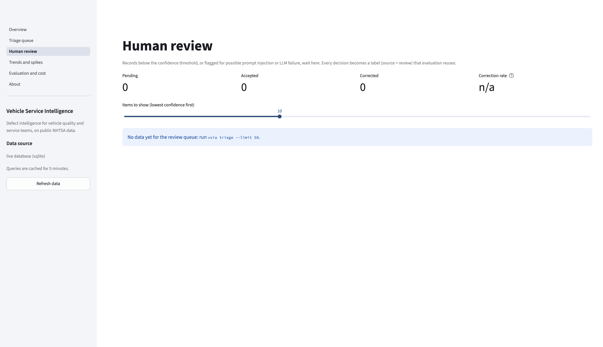
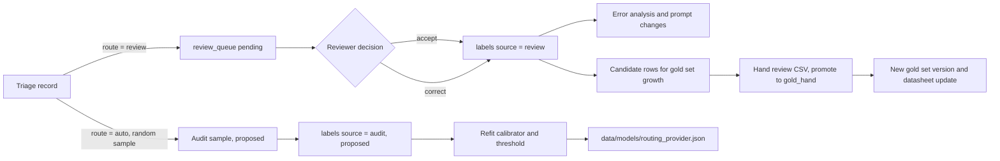
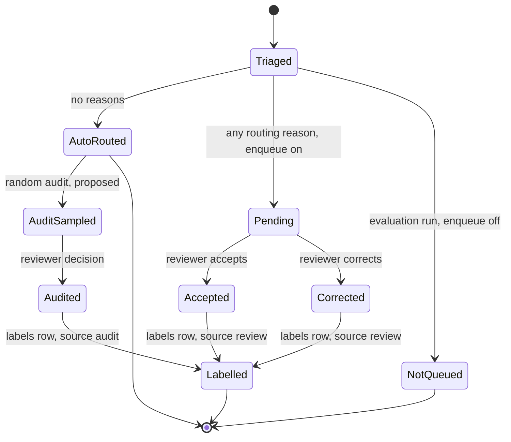

# Human review workflow

How the triage agent decides that a complaint needs a person, how the person decides, and how that
decision flows back into evaluation and calibration. Applies to `src/vsia/agent.py`,
`src/vsia/confidence.py`, `src/vsia/review.py`, `app/views/review.py`, `eval/run_eval.py` and the
`review_queue` and `labels` tables in `src/vsia/db.py`.

Related decisions: ADR-0060 (fixed workflow agent), ADR-0061 (calibrated confidence per provider),
ADR-0062 (severity business rule), ADR-0063 (recall grounding), ADR-0064 (evaluation runs do not enqueue),
ADR-0073 (review UI inside the dashboard), ADR-0040 (silver labels), ADR-0043 (baseline classifier as a
confidence signal). Runbook: [review backlog](../operations/runbooks/review-backlog.md).

Measured values (calibrator coefficients, the tuned threshold, coverage and auto-route accuracy) are written
to `data/models/routing_<provider>.json` by `python -m eval.run_eval calibrate`; gold-split results are in
`docs/evaluation/reports/` and [model-comparison.md](../evaluation/model-comparison.md).

## 1. Where review sits in the triage workflow

Every complaint goes through one fixed sequence in `agent.triage()`: redact PII, check for prompt
injection, call the recall tools, make one structured LLM call, validate (taxonomy, citation grounding),
apply the severity business rule, score confidence, route, persist. Routing is the last decision:

- `route = "auto"`: the triage record is stored in `triage_records` and nothing else happens.
- `route = "review"`: the record is stored and a row is inserted into `review_queue` with
  `status = "pending"` and a human-readable `reason`.

A queue row is created only when `enqueue=True`. Evaluation runs call `triage(..., enqueue=False)` so
that gold and calibration predictions never reach reviewers (ADR-0064). The n8n-native agent variant
(workflow 05) writes `triage_records` directly and creates no queue rows (`workflows/n8n/README.md`).

## 2. Routing reasons

`agent.triage()` builds a list of reasons. Any reason sends the record to review; the reasons are joined
with `"; "` into `review_queue.reason` and kept as a list in `confidence_signals.review_reasons`.

| Reason text (exact) | Condition in code | Type |
|---|---|---|
| `possible prompt injection in complaint text` | `guardrails.detect_injection(summary).score >= 0.5`, or the LLM set `injection_suspected = true` | Hard override |
| `LLM call failed or output invalid twice` | `llm.complete_json()` raised `LLMError` (transport failure after retries, or schema validation failed on both attempts). The record then carries the TF-IDF classifier's label as a fallback output | Hard override |
| `confidence 0.xx below threshold 0.yy` | calibrated confidence `< threshold` for the provider | Score-based |

Hard overrides route to review whatever the score. `eval/run_eval.py` (`_rescore`) keeps hard reasons
from the stored record and recomputes only the score-based one, so a new calibrator or threshold can be
evaluated without new LLM calls.

## 3. Confidence score

### 3.1 Signals

The score is a probability that the predicted component is correct. It is built from six signals that
`agent.triage()` records in `confidence_signals` (feature order is `confidence.FEATURES`):

| Signal | Definition | Source |
|---|---|---|
| `llm_confidence` | The model's self-reported `model_confidence` (0 to 1) from `TriageOutput`. For the `heuristic` provider, the classifier's top probability | LLM output |
| `clf_prob_of_llm_label` | Probability the TF-IDF baseline classifier assigns to the LLM's component | `vsia.classifier` (ADR-0043) |
| `clf_max_prob` | The classifier's top probability over all classes | `vsia.classifier` |
| `agree` | 1.0 if the classifier's top label equals the LLM's component, else 0.0 | derived |
| `retrieval_top_score` | Highest score among the recall-search hits for this complaint (0.0 when none) | `tools.recall_search` |
| `schema_retry` | 1.0 if the first LLM reply failed validation and the second passed, else 0.0 (absent, read as 0, when the LLM failed or the provider is `heuristic`) | `LLMResult.attempts` |

If the classifier model file is missing or fails to load, `_classifier_probs()` returns an empty dict and
the three classifier signals are 0. That silently lowers every score (see section 9).

Other signals are stored for audit but are not score inputs: `pii_redactions`, `injection_score`,
`n_candidates`, `candidates`, `retrieval_ranked`, `llm_severity` (severity before the business rule),
`severity_rule_override`, `citations_dropped`, `component_off_taxonomy`, `llm_error`, `clf_top_label`,
`confidence_method` and `review_reasons`.

### 3.2 Calibrator (primary method)

`confidence.fit()` fits `sklearn.linear_model.LogisticRegression(C=1.0, max_iter=1000)` on the six signals.
The target is 1 when the predicted component is in the complaint's NHTSA component set
(`components_all`, or `component_primary` when that list is empty), else 0: the any-label correctness
used throughout evaluation (`run_eval._correct`).

- Training data: the predictions on the 300-row calibration split for one provider
  (`data/eval/calibration_<provider>.jsonl`). The gold split is never used.
- Diagnostics returned with the fit: `n`, `positive_rate`, 5-fold cross-validated ROC AUC (only when both
  classes are present and `n >= 25`), coefficients and intercept. They are stored in the routing file
  under `calibrator`.
- Storage: `data/models/confidence_calibrator_<provider>.joblib`, loaded once per process and cached.
- `confidence_signals.confidence_method = "logreg_calibrator"`.

### 3.3 Fallback (no calibrator for this provider)

When no calibrator file exists, `confidence.fallback_score()` is used and the record says
`confidence_method = "fallback_weights"`:

```text
score = 0.25 * llm_confidence + 0.45 * clf_prob_of_llm_label + 0.30 * agree
        - 0.10 if schema_retry
clipped to [0, 1]
```

`clf_max_prob` and `retrieval_top_score` are not used by the fallback. The weights are hand-set, not
fitted; treat fallback scores as uncalibrated.

## 4. Threshold

### 4.1 Which threshold applies

`config.confidence_threshold(provider)` resolves in this order:

1. `VSIA_CONFIDENCE_THRESHOLD` environment variable, if set and non-zero. It applies to every provider.
2. `threshold` from `data/models/routing_<provider>.json`, if the file exists.
3. `routing.confidence_threshold` in `config/settings.yaml` (0.70).

### 4.2 Selection rule

`eval/run_eval.py calibrate` scores every calibration-split prediction with the newly fitted calibrator
and sweeps thresholds from 0.300 to 0.950 in steps of 0.025. For each threshold `t`:

- coverage(t) = share of calibration rows with score `>= t` (would be auto-routed);
- accuracy_auto(t) = any-label component accuracy among those rows.

The chosen threshold is the one with the **highest coverage among thresholds whose accuracy_auto is at
least 0.90** (`TARGET_AUTO_ACCURACY`). If no threshold reaches 0.90, the threshold is set to 0.95 and the
file records a `note`. The routing file stores the provider, target, chosen threshold, coverage,
accuracy, fit time, calibrator diagnostics and the full curve; the dashboard's Evaluation page plots that
curve.

Known limitation: the calibrator is fitted and the threshold is chosen on the same 300 rows, so the
calibration-split coverage and accuracy are optimistic. The gold-split metrics `auto_route_rate` and
`auto_route_accuracy_any_label` (see [metrics](../evaluation/metrics.md)) are the out-of-sample check,
and the random audit below is the production check.

Selected values per provider, fitted on the 300-complaint calibration split (`data/models/routing_<provider>.json`):

| Provider | Threshold | Calibration: auto-routed | Calibration: accuracy | Gold: auto-routed | Gold: accuracy |
|---|---|---|---|---|---|
| `heuristic` (TF-IDF) | 0.825 | 19.3% | 0.914 | 19.0% | 0.895 |
| `ollama` (`qwen2.5:3b`) | 0.775 | 28.3% | 0.906 | 27.5% | 0.964 |
| `gemini` (`gemini-3.5-flash-lite`) | 0.775 | 49.0% | 0.905 | 44.0% | 0.875 |

Groq has no calibrator yet; it uses the default threshold 0.70 from `config/settings.yaml`.

## 5. Random audit sampling (recommended, not implemented)

Low-confidence items are reviewed by construction; auto-routed items are not, so nobody would notice if
the threshold drifted out of calibration. The standard human-in-the-loop pattern reviews a random sample
of confident predictions as well (docs/research/01, section 8). Recommendation:

| Parameter | Recommendation | Reason |
|---|---|---|
| Sample | 5% of auto-routed records per day, at least 5 and at most 25 | Small enough for one reviewer, steady signal |
| Extra sample | 100% of auto-routed S1 records for 4 weeks after any change to provider, model, prompt version, calibrator or threshold | S1 errors are the costliest; changes are when drift appears |
| Selection | Uniform random over `triage_records` with `route = 'auto'`, seeded, drawn after the daily batch | Unbiased estimate of auto-route accuracy |
| Blinding | Show the same UI; do not show the confidence value for audit items | Reduces anchoring on the score |
| Label | Write to `labels` with a distinct source, for example `source = 'audit'` | Keeps audit labels separable from low-confidence review labels |
| Sample size | About 140 audits estimate a 90% accuracy within plus or minus 5 points at 95% confidence (1.96^2 x 0.9 x 0.1 / 0.05^2 = 138) | At 25 per day, about one week of audits |

Implementing this changes the `labels.source` vocabulary (a contract in `db.py`) and adds a queue entry
type, so it needs a decision record in the 0060-0069 range first.

## 6. Reviewer UI walkthrough

The review page is part of the Streamlit dashboard (`app/views/review.py`, ADR-0073).



1. **Header metrics.** Pending, Accepted and Corrected counts from `review_queue`, and the correction
   rate = corrected / (accepted + corrected).
2. **Read-only banner.** When the dashboard runs with `VSIA_READONLY=1` or from the demo snapshot, every
   control is disabled and `data.submit_review()` refuses to write (ADR-0072).
3. **Item list.** A slider chooses 5, 10, 20 or 50 items. Items are ordered by lowest confidence first
   (`review.pending()` sorts on `triage_records.confidence` ascending).
4. **Item header.** `ODI <number>: <year> <make> <model> | <component> | <severity> | confidence 0.xx`.
5. **Left column.** The complaint narrative after `guardrails.redact()`.
6. **Right column.** The agent's component, severity and provider; linked recall campaigns (links to the
   NHTSA recall page); "Why it is here", which lists the routing reasons from section 2.
7. **Decision form.**
   - Decision: "Accept agent output" or "Correct".
   - Component: one value from the taxonomy in `config/settings.yaml`, preselected to the agent's value.
   - Severity: S1 to S4 with the rubric's short name, preselected to the agent's value.
   - Recall campaigns: multiselect limited to the campaigns the agent saw as candidates
     (`confidence_signals.candidates`), preselected to the agent's matches.
   - Reviewer (default `analyst`) and an optional note.
   - "Save decision" calls `vsia.review.decide()` and reloads the page with a confirmation message.
   When "Accept" is chosen, the component, severity and campaign fields are ignored.

The same decision can be posted without the dashboard: `POST /review/decision` on the API, or the n8n
webhook `POST /webhook/vsia-review` (workflow 02), both with a `ReviewDecision` body.

## 7. Label schema

`review.decide()` resolves the oldest pending queue item for the complaint and appends one row to
`labels`.

| `labels` column | Value written by a review decision |
|---|---|
| `id` | auto-increment |
| `odi_number` | the complaint |
| `component` | Accept: the agent's component. Correct: the reviewer's component (the agent's if left empty) |
| `severity` | Accept: the agent's severity. Correct: the reviewer's severity (the agent's if left empty) |
| `recall_campaigns` | Accept: the agent's matched campaigns. Correct: the reviewer's list, `[]` meaning "no recall applies" |
| `source` | `review` |
| `reviewer` | free text from the form or API body |
| `note` | free text, optional |
| `created_at` | UTC timestamp |

The queue row gets `status = "accepted"` or `"corrected"` and `resolved_at`. Both tables are append-only
from the application's point of view; a second opinion is a second `labels` row.

Other `source` values in the same table: `gold_silver` (rule-derived labels for the 500 gold and
calibration rows, written by `eval/build_gold.py`, ADR-0040) and `gold_hand` (hand labels promoted from
`data/gold/gold_set_review.csv` with `python eval/build_gold.py --promote`). On 2026-10-19 the table holds
500 `gold_silver` rows and no `review` or `gold_hand` rows (read-only query on `data/vsia.db`).

## 8. Feedback loop



1. **Error analysis.** Corrected items, grouped by `review_queue.reason` and by true versus predicted
   component, are the first input to prompt or taxonomy-glossary changes. Any such change is a new prompt
   version and must pass the regression policy in the [evaluation plan](../evaluation/eval-plan.md).
2. **Recalibration.** Today `calibrate` fits only on the calibration split. Review labels must not be
   added to that fit as they are: they come only from low-confidence items, so they would teach the
   calibrator a biased picture. Use audit labels (random over auto-routed) together with the calibration
   split, or weight review labels by their inverse sampling probability. Refit when at least 100 new audit
   labels exist for a provider, or after any change to provider, model or prompt version.
3. **Gold set growth.** Reviewed complaints are outside the current splits (splits are drawn from the
   corpus at build time and later complaints belong to none). To add them: export reviewed rows into the
   review CSV format, have a second person label them blind, promote agreeing rows with `--promote`, and
   record the new gold version in the gold-set datasheet. Rebuilding with `eval/build_gold.py` re-samples
   every split from the current corpus, which changes gold membership and breaks comparability with
   earlier reports; freeze `data/gold/splits.json` and append instead.
4. **Label leakage.** Review labels are evaluation and calibration data. They must not become input
   features at triage time (AGENTS.md rule 3, ADR-0005).

## 9. Review service level

Proposed targets, measured from `review_queue.created_at` and `resolved_at` joined to
`triage_records.severity`. SLO wording, error budgets and queries are in
[SLOs](../operations/slos.md).

| Item | Target | Escalation |
|---|---|---|
| S1 items | resolved within 1 business day | vehicle quality lead (runbook escalation rule) |
| S2 items | resolved within 2 business days | review owner |
| S3 and S4 items | resolved within 5 business days | review owner |
| Backlog size | at most 25 pending (`VSIA_REVIEW_BACKLOG_THRESHOLD`, workflow 02 hourly check) | [review backlog runbook](../operations/runbooks/review-backlog.md) |

The queue is ordered by confidence, not severity. Reviewers working an S1 target should filter or sort by
severity first; the runbook says the same.

## 10. State of a review item



## 11. Known gaps

- `review.decide()` resolves the **oldest** pending item for an `odi_number`, not the queue item the
  reviewer opened. If a complaint is triaged twice while still pending, a decision made on the newer item
  closes the older one.
- A corrected decision with no campaigns writes `[]`, so "no recall applies" and "reviewer did not check
  recalls" cannot be told apart.
- `review_queue` has no severity or priority column; S1-first ordering needs a join.
- `scripts/deploy_vm.sh` copies `data/models/routing_*.json` to the VM but not
  `confidence_calibrator_<provider>.joblib` or `component_clf.joblib`, and the Docker image excludes
  `data/models/`. On the VM the agent would then score with the fallback weights and zero classifier
  signals (maximum score 0.25) against a threshold tuned for the calibrator, and route nearly everything
  to review. Copy all three artifacts together.
- The random audit (section 5) is not implemented.
