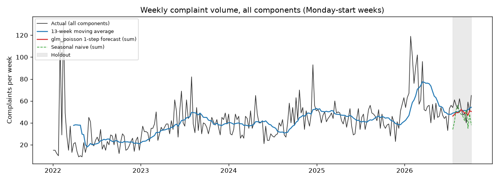
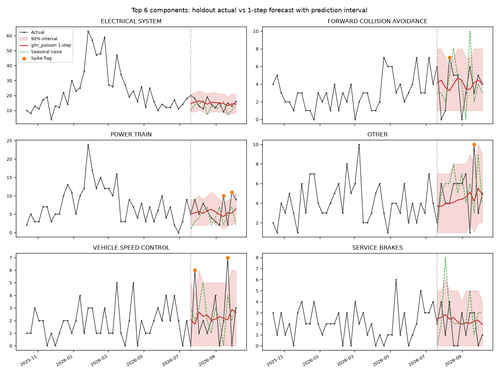

# Backtest report: weekly complaint-volume forecaster

Rolling-origin backtest of the weekly per-component complaint forecaster in `pipelines/forecast.py` and
`pipelines/features.py`, against simple baselines. Model card: [model-card-forecaster.md](model-card-forecaster.md).
Decisions: ADR-0050 to ADR-0055.

## Status

**Completed. A champion is registered.** Training run `train-20261019T182422Z` (MLflow parent run
`6c61abbf263f4e77b195d6d4d4d3c595`, experiment `vsia-forecast`, 2026-10-19 18:24 UTC) finished with all
seven nested candidate runs FINISHED and took 19.3 s. The selection rule chose `glm_poisson`, which is
registered as `vsia-complaint-forecaster` version 1 with alias `champion`, from nested run
`98acce0d6c244ef9a75db49e2e9a1ea5`. Sources: `logs/forecast_train.log`; the MLflow tables `runs`,
`model_versions`, `registered_model_aliases` and `model_version_tags` in `data/mlflow.db`.

| Item | Value | Source |
|---|---|---|
| Registered model, version, alias | `vsia-complaint-forecaster` v1, `@champion`, status READY | `model_versions`, `registered_model_aliases` |
| Champion family and run | `glm_poisson`, run `98acce0d6c244ef9a75db49e2e9a1ea5` | version tags `model_family`, `run_id` |
| Training cut | `train_end_week` 2026-07-13 (last training week before the holdout) | version tag `train_end_week` |
| Holdout 1-step WAPE, ratio to seasonal naive | 50.332, 0.763, `beats_seasonal_naive_1step` True | version tags |
| Data fingerprint | `ba0e4154ef3b8c37` | version tag `data_fingerprint` |
| Other candidate runs | `naive` `4ed02b75a25d448782939c8896ac5348`, `snaive52` `7f4b4c39c02a4625a5697c692c36cb0c`, `ma4` `a38441e4ac224d35aa47e0fa1522daab`, `ma8` `e49a7f37463344adbb22a0110bae09f2`, `ses` `c9d72cda6f724f50b20434e6cf678d95`, `gbm` `217c529707b34a8da67e3a309fba55e1` | run ids line of `logs/forecast_train.log` |

`detect` then ran with the champion and wrote 320 forecast rows (240 out-of-sample rows plus 80 rows for
4 future weeks) and 18 spike alerts (`logs/forecast_detect.log`; `forecasts` and `spike_alerts` tables in
`data/vsia.db`, all rows carrying run id `98acce0d6c244ef9a75db49e2e9a1ea5`).

**Earlier failed runs.** Three train runs earlier on 2026-10-19 (`b27e9d07c7f84d9da27ab31e5c279309` at
05:46 UTC, `5473a25c5bae4bd49c6fd2a223c74b37` and `d40574c4597e4deb8cae876441790561` at 18:23 UTC) are
FAILED in MLflow; each stopped while logging a candidate model, so no champion was registered. ADR-0055
records the cause for the first run: MLflow's default skops format refuses the custom forecaster wrapper
and gradient boosting's `TreePredictor`. The pipeline now logs models with cloudpickle and loads only from
this project's private registry (ADR-0055).

## 1. Series

| Item | Value | Source |
|---|---|---|
| Unit | complaints per Monday-start week per component (`W-MON`) | `config/settings.yaml` `forecast.freq` |
| Label | NHTSA `component_primary` (reference data for counting; never a triage model input) | `complaints` table |
| Weeks | 249, 2022-01-03 to 2026-10-05 | MLflow params `n_weeks`, `first_week`, `last_week` |
| Partial weeks | Leading and trailing partial weeks dropped; the latest complaint is 2026-10-15, so the week of 2026-10-12 is excluded | `weekly_counts()` |
| Series | 20: 19 components plus OTHER | MLflow param `n_components` |
| Pooled into OTHER | ELECTRONIC STABILITY CONTROL (1 complaint), HYBRID PROPULSION SYSTEM (3), LATCHES/LOCKS/LINKAGES (22), PARKING BRAKE (10): fewer than 30 in total | MLflow param `pooled_components`; `min_weekly_total: 30`; counts from `data/vsia.db` |
| Data fingerprint | `ba0e4154ef3b8c37` | MLflow tag `data_fingerprint` |

MLflow params and tags in this table are those of parent run `6c61abbf263f4e77b195d6d4d4d3c595`.

The overall series ([plot](forecast-plots/overall_weekly_volume.png)) runs from about 10 to about 120
complaints per week (the first weeks of 2022 and early 2026 exceed 120), with a rise in level through
2023 and a surge in early 2026.



## 2. Backtest design

Rolling forecasting origin (FPP3 chapter 5, docs/research/01 section 12):

| Fold | Role | First target week | Weeks |
|---|---|---|---|
| 0 | validation | 2025-11-10 | 12 |
| 1 | validation | 2026-02-02 | 12 |
| 2 | validation | 2026-04-27 | 12 |
| 3 | holdout | 2026-07-20 | 12 (to 2026-10-05) |

Fold starts are read from the `fold_start` column of each candidate's `forecasts.csv` artifact.

- **Parameters are fixed at each fold start.** Models (and SES smoothing constants) are fitted only on
  targets before the fold's first week (`training_rows()` drops any row whose target is at or after the
  cut).
- **1-step mode (headline):** for each target week, the origin is the previous week, so lag features use
  actuals up to the week before. This matches weekly operation, where each Monday's forecast is made with
  last week's count.
- **Direct mode:** from the single origin before the fold, forecasts for horizons 1 to 12.
- **Seasonal features** read the same week one year before the target, which is known for horizons up to
  51.
- **Seed** 42 for every fit.

### Candidates

| Name | Kind | Point forecast | Interval |
|---|---|---|---|
| `naive` | baseline | last week's count | Poisson |
| `snaive52` | baseline | same week one year earlier | Poisson |
| `ma4`, `ma8` | baseline | mean of the last 4 or 8 weeks | Poisson |
| `ses` | per-series statistical | simple exponential smoothing per component, alpha by grid search on in-sample 1-step squared error | Poisson |
| `glm_poisson` | global ML | Poisson GLM over one-hot component, log1p-scaled lags and rolling means, seasonal lags, total-volume lags, horizon and week-of-year terms | Poisson |
| `gbm` | global ML | `HistGradientBoostingRegressor`, Poisson loss, component as a categorical feature, same features | Two quantile GBMs at 0.05 and 0.95 |

Features (MLflow param `features`): `component, h, lag1, lag2, lag3, lag4, lag8, lag13, roll4, roll8,
roll13, slag52, slag52_mean3, total_lag1, total_roll4, woy_sin, woy_cos`. GBM settings: learning rate
0.05, 300 iterations, 15 leaf nodes, minimum 20 samples per leaf, L2 1.0, no early stopping.

### Metrics

Definitions are in `pipelines/features.py`; all percentages are in percent.

| Metric | Definition |
|---|---|
| WAPE | `sum abs(y - f) / sum y` over all component-weeks. Headline (`HEADLINE = "wape"`) |
| MAE | mean absolute error per component-week, in complaints |
| MASE (volume-weighted) | per component, MAE divided by the in-sample MAE of the 52-week seasonal naive on that fold's training data (Hyndman and Koehler, 2006); averaged across components weighted by actual volume. Below 1 means better than the seasonal naive's typical in-sample error |
| sMAPE, MAPE (volume-weighted) | per component, then volume-weighted; MAPE skips zero actuals |
| Total-volume MAPE | MAPE of the weekly sum over all components |
| Coverage | share of component-weeks whose actual lies inside the interval; nominal 0.90 |
| WAPE vs seasonal naive | holdout WAPE divided by `snaive52`'s holdout WAPE; below 1 beats it |

### Selection rule

`register_champion()` picks, **among `glm_poisson` and `gbm` only**, the model with the lowest mean
validation 1-step WAPE over the three validation folds. Baselines and SES are benchmarks: they are scored
and logged but are not eligible for the registry (ADR-0051, ADR-0052).

## 3. Results

Holdout is fold 3 (240 component-weeks, 649 complaints). Validation columns average folds 0 to 2.

| Model | Val WAPE 1-step | Val MASE 1-step | Holdout WAPE 1-step | Holdout MAE | Holdout MASE | Holdout sMAPE | Total-volume MAPE | Coverage | WAPE vs snaive | Holdout WAPE direct | Direct vs snaive |
|---|---|---|---|---|---|---|---|---|---|---|---|
| naive | 60.31 | 1.193 | 67.95 | 1.84 | 1.355 | 71.66 | 14.49 | 0.696 | 1.030 | 62.10 | 0.942 |
| snaive52 | 69.55 | 1.502 | 65.95 | 1.78 | 1.249 | 73.95 | 20.47 | 0.721 | 1.000 | 65.95 | 1.000 |
| ma4 | 50.95 | **1.054** | 53.51 | 1.45 | 1.030 | 59.55 | 13.82 | 0.883 | 0.811 | 52.08 | 0.790 |
| ma8 | 53.02 | 1.206 | 51.56 | 1.39 | 1.012 | 59.25 | 14.32 | 0.908 | 0.782 | **49.77** | **0.755** |
| ses | **50.32** | 1.060 | 50.43 | 1.36 | **0.964** | 58.42 | **11.59** | 0.921 | 0.765 | 50.24 | 0.762 |
| glm_poisson | 53.00 | 1.161 | **50.33** | **1.36** | 0.974 | **58.41** | 12.63 | 0.908 | **0.763** | 51.46 | 0.780 |
| gbm | 53.80 | 1.162 | 50.83 | 1.37 | 0.992 | 60.23 | 17.14 | 0.854 | 0.771 | 51.12 | 0.775 |

Source: the completed run, that is the summary table printed in `logs/forecast_train.log`, the
`summary.csv` artifact of parent run `6c61abbf263f4e77b195d6d4d4d3c595`, and the MLflow metrics
`val_wape_1step`, `val_mase_1step`, `hold_*` and `rel_wape_vs_snaive_*` of its seven candidate runs. Every
value is identical, after rounding, to the table first taken from failed run
`b27e9d07c7f84d9da27ab31e5c279309`. Bold marks the best value per column; coverage has no bold because the goal is closeness to 0.90,
not the highest value.

### Reading

1. **The champion rule selected `glm_poisson`** (validation WAPE 53.00 against 53.80 for `gbm`), now
   registered as `vsia-complaint-forecaster` v1 `@champion`.
2. **Two simple methods did better on validation than both eligible models**: SES (50.32) and the 4-week
   moving average (50.95). On the holdout, `glm_poisson` (50.33) and SES (50.43) are within 0.1 points,
   with `gbm` at 50.83 and `ma8` at 51.56. With 649 complaints in the holdout, differences of about 1
   WAPE point are not evidence that one model is better.
3. **Every model except `naive` beats the seasonal naive on the holdout** (WAPE ratio below 1); the
   seasonal naive is the worst model on validation. This suggests that annual seasonality matters less in
   this series than shifts in level.
4. **Intervals:** the Poisson intervals of `glm_poisson`, `ses` and `ma8` cover 0.908 to 0.921 of
   holdout component-weeks against 0.90 nominal; the quantile-GBM interval under-covers at 0.854. Naive
   and seasonal naive intervals under-cover badly (0.696, 0.721) because their point forecasts are noisy.
5. **Total weekly volume** is forecast much better than individual components: total-volume MAPE 11.6 to
   12.6 for SES and `glm_poisson`, against component WAPE around 50. Most error comes from sparse
   components.
6. **Direct multi-step** forecasts (horizons 1 to 12 from one origin) score about the same WAPE as 1-step
   forecasts, again because weekly counts are dominated by noise rather than by short-term dynamics.

### Per-component holdout, `glm_poisson`, 1-step

From `per_component_1step.csv` of champion run `98acce0d6c244ef9a75db49e2e9a1ea5` (byte-identical to the
same file in the earlier failed run `ce5c1a2652dc429c91df2973f1cc55ff`).

| Component | Holdout complaints | Zero weeks | WAPE | MASE | Coverage |
|---|---|---|---|---|---|
| ELECTRICAL SYSTEM | 175 | 0 | 20.6 | 0.397 | 1.000 |
| POWER TRAIN | 74 | 0 | 43.9 | 0.831 | 0.833 |
| STEERING | 68 | 0 | 44.5 | 1.048 | 0.750 |
| SUSPENSION | 61 | 1 | 61.0 | 3.588 | 0.667 |
| OTHER | 60 | 0 | 40.4 | 0.885 | 0.833 |
| FORWARD COLLISION AVOIDANCE | 45 | 2 | 51.5 | 0.525 | 0.750 |
| VEHICLE SPEED CONTROL | 28 | 3 | 80.0 | 0.818 | 0.833 |
| SERVICE BRAKES | 22 | 3 | 77.9 | 0.657 | 1.000 |
| STRUCTURE | 20 | 2 | 58.0 | 0.907 | 1.000 |
| AIR BAGS | 18 | 2 | 60.5 | 0.807 | 0.917 |
| VISIBILITY/WIPER | 15 | 5 | 80.0 | 0.484 | 0.917 |
| BACK OVER PREVENTION | 14 | 3 | 74.1 | 1.095 | 0.917 |
| EXTERIOR LIGHTING | 10 | 4 | 67.7 | 0.530 | 1.000 |
| LANE DEPARTURE | 9 | 4 | 72.0 | 0.636 | 1.000 |
| FUEL/PROPULSION SYSTEM | 7 | 9 | 158.3 | 1.275 | 0.917 |
| WHEELS | 6 | 6 | 104.3 | 1.109 | 1.000 |
| ENGINE | 5 | 10 | 206.9 | 0.638 | 0.917 |
| SEAT BELTS | 5 | 9 | 153.5 | 0.970 | 0.917 |
| TIRES | 5 | 7 | 115.2 | 1.033 | 1.000 |
| SEATS | 2 | 10 | 226.2 | 0.851 | 1.000 |

Percentage errors are not meaningful for components with fewer than about 20 complaints in 12 weeks;
read MASE and coverage for those. SUSPENSION is the clear miss: a cluster in late July and August 2026
(15 complaints in the week of 2026-08-03) that no model anticipated, which is what spike alerts are for.



The plot shows the six highest-volume series for the 40 weeks before the holdout and the holdout itself,
with the `glm_poisson` 1-step forecast, its 90% interval, the seasonal naive and the weeks flagged as
spikes.

## 4. Spike alerts and out-of-sample checks

The spike rule (ADR-0054) flags a component-week when the actual is strictly above the interval upper
bound and at least 3 complaints. `detect` ran with the champion on 2026-10-19 (rows created at 18:24 UTC)
and evaluated the 12 complete weeks after the training cut, 2026-07-20 to 2026-10-05: 20 components by
12 weeks, 240 component-weeks. These are the same weeks as backtest fold 3, so the checks below confirm
the stored champion reproduces the backtest; they are not a second, independent test. The stored
out-of-sample rows reproduce the holdout WAPE: 50.33 over 649 complaints (query on `forecasts` where
`is_holdout = 1`).

### Alerts

| Item | Value | Source |
|---|---|---|
| Alerts stored | 18 of 240 component-weeks (7.5%) | `spike_alerts` (18 rows, weeks 2026-07-20 to 2026-10-05); `logs/forecast_detect.log` |
| Current alerts (last 4 complete weeks, 2026-09-14 to 2026-10-05) | 8 | `RECENT_WEEKS = 4` in `pipelines/forecast.py`; `logs/forecast_detect.log`; count by week in `spike_alerts` |
| Repeated components | SUSPENSION 4 alerts, STEERING 3, POWER TRAIN 2, VEHICLE SPEED CONTROL 2 | `spike_alerts` |
| Backtest cross-check | the rule applied to the holdout rows of the champion run's `forecasts.csv` gives the same 18 flags; `ses` gives 14 (5.8%) | artifacts of runs `98acce0d6c244ef9a75db49e2e9a1ea5` and `c9d72cda6f724f50b20434e6cf678d95` |

| Component | Week | Actual | Forecast | Upper | Current | Same-component recall near (pipeline definition) |
|---|---|---|---|---|---|---|
| AIR BAGS | 2026-07-20 | 4 | 1.02 | 3 | no | 26V545000 (report date 2026-08-21) |
| SUSPENSION | 2026-07-27 | 7 | 1.24 | 3 | no | |
| VEHICLE SPEED CONTROL | 2026-07-27 | 6 | 1.71 | 4 | no | |
| STEERING | 2026-08-03 | 8 | 3.64 | 7 | no | |
| SUSPENSION | 2026-08-03 | 15 | 1.86 | 4 | no | 26V558000 (2026-09-01) |
| FORWARD COLLISION AVOIDANCE | 2026-08-10 | 7 | 3.24 | 6 | no | |
| STEERING | 2026-08-10 | 9 | 4.39 | 8 | no | |
| FUEL/PROPULSION SYSTEM | 2026-08-17 | 4 | 0.64 | 2 | no | |
| STEERING | 2026-08-24 | 10 | 5.21 | 9 | no | |
| SUSPENSION | 2026-08-31 | 7 | 2.89 | 6 | no | 26V558000 (2026-09-01) |
| POWER TRAIN | 2026-09-14 | 10 | 4.36 | 8 | yes | |
| OTHER | 2026-09-21 | 10 | 4.22 | 8 | yes | 26V571000 (2026-09-02) |
| VEHICLE SPEED CONTROL | 2026-09-21 | 7 | 2.07 | 5 | yes | |
| VISIBILITY/WIPER | 2026-09-21 | 4 | 1.28 | 3 | yes | |
| POWER TRAIN | 2026-09-28 | 11 | 5.24 | 9 | yes | |
| BACK OVER PREVENTION | 2026-10-05 | 3 | 0.73 | 2 | yes | 26V597000 (2026-09-16) |
| ENGINE | 2026-10-05 | 3 | 0.56 | 2 | yes | 26V659000 (2026-10-07) |
| SUSPENSION | 2026-10-05 | 6 | 2.36 | 5 | yes | |

Source: `logs/forecast_detect.log` (the `spike_alerts` table stores actual, upper and ratio but not the
point forecast); recall report dates from the `recalls` table.

With a central 90% interval, about 5% of component-weeks (about 12 of 240) would exceed the upper bound by
chance alone, so most alerts are expected noise rather than defect clusters. Repeated alerts on one
component are the stronger signal.

### Interval coverage on out-of-sample weeks

Computed from the `forecasts` table as the share of rows with `actual` not null and `week` after the
champion's `train_end_week` (2026-07-13) for which `lower <= actual <= upper`:

| Item | Value |
|---|---|
| Inside the 90% interval | 218 of 240 (0.908), matching `logs/forecast_detect.log` |
| Below the lower bound | 3 |
| Above the upper bound | 19 (18 of them with at least 3 complaints, which are the alerts) |

Overall coverage is close to the 0.90 nominal, but the misses are lopsided: 19 above and 3 below, against
about 12 expected on each side of a central 90% interval. This is consistent with weekly counts being more
variable upward than the Poisson interval assumes, which also explains why alerts (7.5%) exceed the 5%
chance rate.

### Do alerts anticipate recalls?

For each alert, the check asks whether a recall in the `recalls` table (200 campaigns, report dates
2020-11-12 to 2026-10-07) on an overlapping component was reported near the alert week. The base rate
applies the same check to all 240 out-of-sample component-weeks. Recall rows were de-duplicated by
campaign. Two definitions were computed with a read-only script on `data/vsia.db`:

- **A, pipeline definition** (`near_recall()` in `pipelines/forecast.py`, `RECALL_WINDOW_DAYS = 28`):
  `recalls.component_primary` equals the alert component, and the report date falls between 28 days
  before the week start and 28 days after the week end (week start plus 34 days).
- **B, symmetric definition**: `recalls.component_primary` or the first colon-separated segment of
  `recalls.component_raw` equals the alert component, and the report date is within plus or minus 28
  days of the week start. In practice the `component_raw` segment added no alert matches; the narrower
  window is what changes the result.

| Definition | Alerts with a recall near | Base rate, all 240 component-weeks | Base rate, 222 non-alert component-weeks | Chance of at least this many by luck (binomial at the base rate) |
|---|---|---|---|---|
| A, pipeline | 6 of 18 (0.333) | 73 of 240 (0.304) | 67 of 222 (0.302) | 0.48 |
| B, symmetric | 4 of 18 (0.222) | 68 of 240 (0.283) | 64 of 222 (0.288) | 0.80 |

Definition A reproduces the `detect` log (6 of 18 against a base rate of 0.304). Restricting the base rate
to the 11 components that had alerts gives 0.318 under A and 0.280 under B. The binomial figure is only a
rough guide, because component-weeks are not independent: one recall matches about nine consecutive weeks
of its component under definition A.

Timing of the six matches under definition A, relative to the alert week start: two recalls came before
the alert (OTHER, 26V571000, 19 days earlier; BACK OVER PREVENTION, 26V597000, 19 days earlier), two fell
inside the alert week (SUSPENSION on 2026-08-31, 1 day later; ENGINE on 2026-10-05, 2 days later), and two
came about a month later (SUSPENSION on 2026-08-03, 29 days later; AIR BAGS on 2026-07-20, 32 days
later). Both SUSPENSION matches point to the same recall, 26V558000. Only two alerts led a recall by more
than a week, and both fall outside a symmetric 28-day window.

**Conclusion:** on this data, spike alerts do not anticipate recalls. The share of alerts near a recall
(0.333 or 0.222, depending on the definition) is no higher than the base rate for ordinary component-weeks
(0.304 or 0.283). With 18 alerts the check has little power, and recall report dates reflect manufacturer
filing schedules, so this is weak evidence either way. It does not support presenting alerts as early
warnings of recalls; they remain "more complaints than expected" signals for an analyst to investigate.

## 5. Open items

| Item | Status |
|---|---|
| Interval coverage and alert behaviour on weeks after 2026-10-05 | not yet measured; needs later `detect` runs once those weeks are complete. The 80 future rows (2026-10-12 to 2026-11-02) have no actuals yet |
| Refit of the champion on all 249 weeks | not done: the registered model is the one fitted for the holdout fold (`train_end_week` 2026-07-13), and no decision record covers refitting before serving |
| A stronger external check for alerts (for example, longer windows or NHTSA investigation openings) | not yet measured |
| Registry-eligible models against simple baselines | open: SES and the 4-week moving average had lower validation WAPE than the champion (section 3) |

## 6. How to reproduce

```bash
source .venv/bin/activate
python -m pipelines.forecast train --force   # backtest, MLflow runs, plots, register champion
python -m pipelines.forecast detect          # forecasts + spike alerts from the champion
pytest tests/test_forecast.py                # unit tests on synthetic data
```

`train` without `--force` is skipped when the champion's `data_fingerprint` tag equals the current one
(ADR-0053). Plots are written to `docs/models/forecast-plots/` and logged to the parent run.
