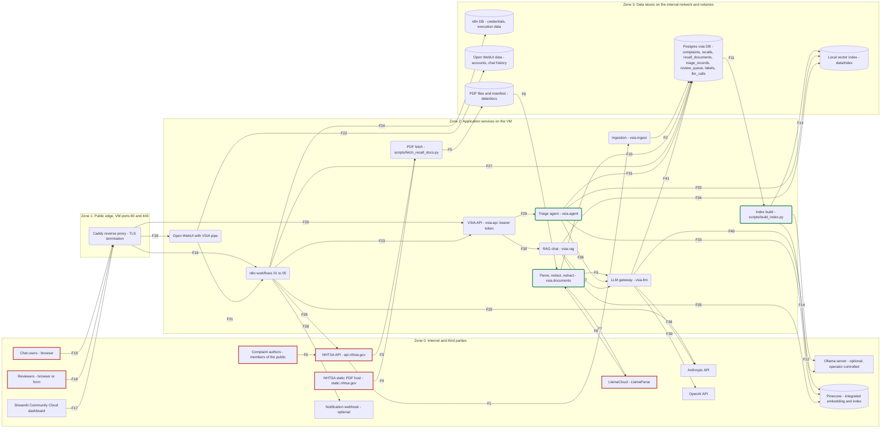
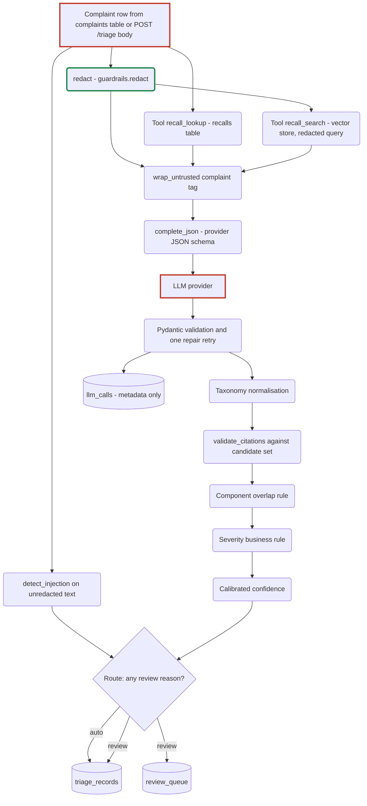
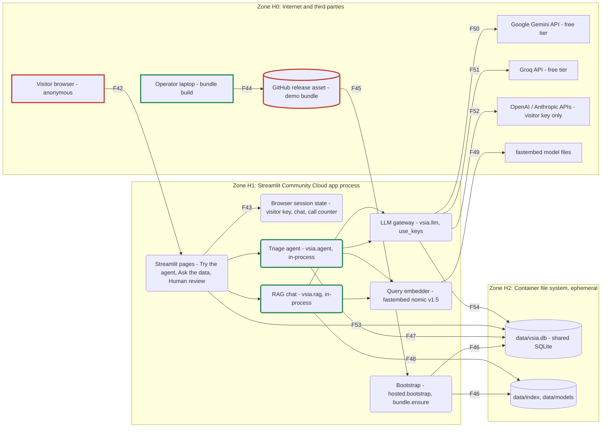

# Data flow diagram and trust boundaries

- **Status:** Current as of 2026-10-19 (code at the same date)
- **Scope:** The OCI VM deployment (ADR-0080) plus the batch jobs that build its data. Laptop mode
  collapses zones 1 to 3 onto one machine, uses SQLite and a local Ollama server, and has no Caddy,
  n8n or Open WebUI (see `docs/architecture/deployment.md`). The hosted demo on Streamlit Community Cloud
  (ADR-0088 to ADR-0092) has its own zones and flows, F42 to F54, in section 6.
- **Method:** OWASP Threat Modeling Cheat Sheet system model (external entities, processes, data
  stores, data flows, trust boundaries), as recommended in
  `docs/research/01_documentation_process_research.md` section (c) topic 4.
- **Used by:** `docs/security/threat-model.md` (STRIDE per boundary), `docs/security/pii-handling.md`
  (redaction points), `docs/security/guardrails.md`.

VSIA is defect intelligence for vehicle quality and service teams, built on public NHTSA data. The
single most important property of this diagram is that **owner complaint narratives are untrusted text
written by members of the public**. They enter at flow F1, are stored unredacted in `complaints.summary`
(they are already public), and are redacted every time they move towards an LLM, an embedding model, a
log line or a screen.

## Notation

| Element | Mermaid shape | Meaning |
|---|---|---|
| External entity | rectangle `[...]` | Outside the project's control |
| Process | rounded `(...)` | Code in this repository or a service it configures |
| Data store | cylinder `[(...)]` | Persistent state |
| Trust boundary | subgraph | A zone; every arrow that leaves a subgraph crosses a boundary |
| Untrusted entry | red outline | Where text the project does not control enters |
| Redaction point | green outline | Where `vsia.guardrails.redact()` runs |

Flow labels (F1, F2, ...) refer to the table in section 3.

## 1. Level 0: zones, entities and stores

Notes on the level 0 view:

- Postgres sits only on the `backend` Docker network, which is `internal: true` (no egress, no published
  port). Caddy is the only container that publishes ports (`infra/compose/docker-compose.yml`, ADR-0083).
- MLflow is omitted: it holds forecasting metrics and model artifacts, no complaint text, and binds to
  `127.0.0.1:5000` for SSH tunnels only (ADR-0081, ADR-0083).
- `ING`, `FETCH`, `DOCS` and `IDX` are batch jobs. `ING` is also triggered over the API by n8n workflow 01
  (`POST /ingest/daily`); `FETCH`, `DOCS` and `IDX` are run by the operator from the CLI.
- `RAG` is not outlined green because it does **not** redact the chat question before the LLM call
  (see section 4, gap G1).

## 2. Level 1: triage agent request path with guardrail positions

This view zooms into `AGENT` and `GW` for one complaint. It is the order of operations in
`vsia.agent.triage()` (`src/vsia/agent.py` lines 93 to 181).

The provider reply is treated as untrusted output: nothing from it is persisted until it has passed
schema validation (V1) and the semantic checks (V2 to V5). Each step is described in
`docs/security/guardrails.md`.

## 3. Flows that cross a trust boundary

"Untrusted" means the content can carry instructions or malformed data the project does not control.
"PII state" describes the payload as it crosses the boundary.

| ID | From | To | Data | Boundary crossed | Transport and auth | Untrusted? | PII state | Code |
|---|---|---|---|---|---|---|---|---|
| F0 | Complaint authors | NHTSA API | Free-text narrative and vehicle data | Outside the system | NHTSA web form | Yes | Raw; NHTSA masks some fields as `[XXX]` | n/a |
| F1 | NHTSA API | Ingestion | Complaint JSON (narrative, flags, VIN prefix, NHTSA component codes) and recall JSON | Zone 0 to 2 | HTTPS, no auth, `User-Agent: vsia/0.1`, retry on 429 and 5xx | **Yes, main entry point** | Raw narrative | `vsia/nhtsa.py` `complaints_by_vehicle`, `recalls_by_vehicle` |
| F2 | Ingestion | Postgres `complaints`, `recalls` | Normalised rows | Zone 2 to 3 | SQLAlchemy over internal network | Yes (stored as received) | **Unredacted** `summary`; `vin_prefix` as returned by NHTSA | `vsia/ingest.py` `ingest_complaints` |
| F3 | NHTSA API | PDF fetch | Document listing (`safetyIssues/byNhtsaId`) | Zone 0 to 2 | HTTPS, no auth, about 3 requests per second | Yes | None expected | `scripts/fetch_recall_docs.py` |
| F4 | NHTSA static PDF host | PDF fetch | Part 573 reports and owner letters (PDF) | Zone 0 to 2 | HTTPS, no auth, size caps 1 MB and 3 MB, SHA-256 in manifest | **Yes, indirect injection entry point** | Sample names, addresses, company phone numbers | `scripts/fetch_recall_docs.py` |
| F5 | PDF fetch | `data/docs` | PDF files, `manifest.json` | Zone 2 to 3 | Local filesystem | Yes | Raw | same |
| F6 | `data/docs` | Parse and extract | PDF bytes | Zone 3 to 2 | Local filesystem | Yes | Raw | `vsia/documents.py` `parse_pdf` |
| F7 | Parse and extract | LlamaCloud | Whole PDF upload (only when `LLAMA_CLOUD_API_KEY` is set) | Zone 2 to 0 | HTTPS, API key | n/a (outbound) | **Unredacted PDF**; the documents are public NHTSA files | `vsia/documents.py` `parse_pdf` |
| F8 | LlamaCloud | Parse and extract | Markdown | Zone 0 to 2 | HTTPS | Yes | Raw | same |
| F9 | Parse and extract | LLM gateway | Redacted document text inside `<document>` tags (LLM fallback only) | Internal, then F38 to F40 | In-process | Yes | **Redacted** (`documents.py` line 255) | `vsia/documents.py` `extract_llm` |
| F10 | Parse and extract | Postgres `recall_documents` | Redacted markdown and validated extraction | Zone 2 to 3 | SQLAlchemy | Yes | **Redacted before storage** | `vsia/documents.py` `process` |
| F11 | Postgres | Index build | Complaints, recalls, recall document markdown | Zone 3 to 2 | SQLAlchemy | Yes | Complaints raw in the DB, redacted in the job; documents already redacted; recall API text not redacted (public manufacturer text) | `scripts/build_index.py` |
| F12 | Index build | Ollama server | Text to embed (`nomic-embed-text`) | Zone 2 to 0 or localhost | HTTP to `OLLAMA_BASE_URL` (no auth) | n/a (outbound) | Redacted complaints and documents | `vsia/llm.py` `embed_ollama` |
| F13 | Index build | Local vector index | Vectors plus record text and metadata (`meta.jsonl`) | Zone 2 to 3 | Local filesystem | Yes | Redacted complaint text; NHTSA component labels excluded | `vsia/retrieval.py` `LocalStore.upsert` |
| F14 | Index build | Pinecone | Text records (`chunk_text`) for integrated embedding | Zone 2 to 0 | HTTPS, API key | n/a (outbound) | Redacted complaint text and documents | `vsia/retrieval.py` `PineconeStore.upsert` |
| F15 | Chat users | Caddy | Chat page and messages | Zone 0 to 1 | HTTPS (Let's Encrypt), Open WebUI login | **Yes** | Whatever the user types | `infra/compose/Caddyfile` |
| F16 | Reviewers | Caddy | Review decisions (`ReviewDecision` JSON) | Zone 0 to 1 | HTTPS; n8n webhook header auth `Authorization: Bearer <N8N_BEARER>` | Yes | Free-text `note`, `reviewer` | `workflows/n8n/02_review_queue_digest.json` |
| F17 | Streamlit Community Cloud | Caddy | Dashboard reads (documented); in code the app reads the database or a demo snapshot | Zone 0 to 1 | HTTPS, bearer token per `docs/architecture/deployment.md` | n/a | Redacted on read in `app/data.py` | see gap G9 |
| F18 | Caddy | Open WebUI | Proxied HTTP | Zone 1 to 2 | Plain HTTP on the Docker `frontend` network | Yes | As F15 | `Caddyfile` |
| F19 | Caddy | n8n | Editor traffic and webhook calls (`vsia-chat`, `vsia-review`, `vsia-triage-native`) | Zone 1 to 2 | Plain HTTP inside Docker; webhook header auth enforced by n8n | Yes | As received | `Caddyfile`, ADR-0077 |
| F20 | Caddy | VSIA API | Direct API calls | Zone 1 to 2 | Plain HTTP inside Docker; bearer `VSIA_API_TOKEN` enforced by the API on every route except `/health` | Yes | As received | `vsia/api.py` `auth` |
| F21 | Open WebUI pipe | n8n workflow 04 | `{question, messages, user_id}` | Within zone 2 | HTTP `http://n8n:5678/webhook/vsia-chat`, bearer valve `N8N_BEARER` | Yes | **Unredacted** question and full message history | `openwebui/vsia_pipe.py` line 98 |
| F22 | Open WebUI | Open WebUI data | Accounts and chat history | Zone 2 to 3 | Docker volume | Yes | Unredacted chat history | Open WebUI |
| F23 | n8n | VSIA API | `/ingest/daily`, `/triage/pending`, `/review/*`, `/chat`, `/forecast/run`, `/search` | Within zone 2 | HTTP, Header Auth credential `VSIA API bearer` | Yes (forwarded bodies) | Chat question unredacted | `workflows/n8n/*.json` |
| F24 | n8n | n8n DB | Execution data including webhook payloads, kept 336 hours | Zone 2 to 3 | Postgres | Yes | **Unredacted** chat questions and history from F21 | `docker-compose.yml` `EXECUTIONS_DATA_MAX_AGE` |
| F25 | n8n workflow 05 | Anthropic | Complaint redacted by a JavaScript subset of `redact()` | Zone 2 to 0 | HTTPS, n8n Anthropic credential | n/a (outbound) | Partly redacted: no address or name rules | `05_triage_agent_native.json` node "Redact PII" |
| F26 | n8n workflow 05 | NHTSA API | Recall lookup tool call; response enters the agent context | Zone 2 to 0 to 2 | HTTPS, no auth, 20 s timeout | **Yes, tool output** | None expected | node "NHTSA Recalls Tool" |
| F27 | n8n workflow 05 | Postgres `triage_records` | Agent output | Zone 2 to 3 | Postgres credential `VSIA Postgres` (user `vsia`) | Model output | As produced | node "Insert Triage Record" |
| F28 | n8n | Notification webhook | Backlog counts and alert summaries | Zone 2 to 0 | HTTPS to `VSIA_NOTIFY_WEBHOOK_URL` (nodes disabled by default) | n/a | Counts only | workflows 01 to 03 |
| F29 | VSIA API | Triage agent | Complaint by `odi_number` or a caller-supplied `Complaint` body | Within zone 2 | In-process | Yes | Raw | `vsia/api.py` `triage_one` |
| F30 | VSIA API | RAG chat | Question | Within zone 2 | In-process | Yes | Raw | `vsia/api.py` `chat` |
| F31 | Triage agent | Postgres | Reads `complaints`, `recalls`; writes `triage_records`, `review_queue` | Zone 2 to 3 | SQLAlchemy | Model output after validation | Output fields derived from redacted text, except gap G2 | `vsia/agent.py` `save` |
| F32, F33 | Triage agent | Vector store | Redacted query (first 2,000 characters) and vehicle filter | Zone 2 to 3 or 0 | Local files or HTTPS to Pinecone | Results are untrusted retrieved text | **Redacted** | `vsia/retrieval.py` `search_recalls_for_complaint` |
| F34, F35 | RAG chat | Vector store | Redacted search text and filters | Zone 2 to 3 or 0 | Local files or HTTPS | Results are untrusted retrieved text | **Redacted** (`retrieval.py` line 566) | `vsia/rag.py` `answer` |
| F36 | Triage agent | LLM gateway | System prompt plus redacted, wrapped complaint and candidate recall text | Internal | In-process | Yes | **Redacted** complaint; recall text public | `vsia/agent.py` `_user_message` |
| F37 | RAG chat | LLM gateway | Plan and answer prompts: wrapped question plus retrieved context | Internal | In-process | Yes | **Question not redacted** (gap G1) | `vsia/rag.py` `_plan`, `answer` |
| F38 | LLM gateway | Anthropic | Messages API with JSON schema output | Zone 2 to 0 and back | HTTPS, `x-api-key` | Reply is untrusted output | As F36 or F37 | `vsia/llm.py` `_call_anthropic` |
| F39 | LLM gateway | OpenAI | Responses API with strict JSON schema | Zone 2 to 0 and back | HTTPS, bearer API key | Reply is untrusted output | As F36 or F37 | `vsia/llm.py` `_call_openai` |
| F40 | LLM gateway | Ollama | `/api/chat` with `format` schema | Zone 2 to 0, or localhost on the laptop | HTTP, no auth | Reply is untrusted output | As F36 or F37 | `vsia/llm.py` `_call_ollama` |
| F41 | LLM gateway | Postgres `llm_calls` | Provider, model, purpose, tokens, cost, latency, ok, error, prompt version, reference id | Zone 2 to 3 | SQLAlchemy | No prompt text | Metadata; `error` can hold validator excerpts (gap G6) | `vsia/llm.py` `complete_json`, `vsia/db.py` `log_llm_call` |

## 4. Where untrusted text enters, and where redaction happens

Untrusted entry points (red outline):

| Entry | Flow | Content | First control applied |
|---|---|---|---|
| Owner complaint narratives | F1 | Free text from the public | Stored as received; `redact()` and `detect_injection()` at triage time |
| Recall PDFs | F4, F8 | Third-party documents | `redact()` before storage; wrapped in `<document>` for the LLM fallback |
| Chat questions | F15, F21 | Free text from logged-in chat users | Wrapped in `<question>`; **not redacted** before the LLM |
| Review decisions | F16 | JSON from reviewers | Pydantic `ReviewDecision` schema; header auth |
| Caller-supplied complaint on `POST /triage` | F20, F29 | Any `Complaint` JSON | Bearer token; same triage guardrails |
| Retrieved records | F32 to F35 | Indexed text (complaints, recall docs) | Complaint and document text redacted at index time; not tag-neutralised (gap G3) |
| LLM replies | F38 to F40 | Model output | Schema validation and semantic checks before persistence |
| n8n tool output | F26 | NHTSA recall JSON inside the native agent | None beyond the system prompt (workflow 05 is a demo variant) |
| Hosted demo visitor input | F42 | Written complaints, chat questions, review notes, API keys | Same triage and chat guardrails; length caps 2,000 and 500 characters; keys kept in session state (section 6) |
| Hosted demo data bundle | F45 | Database, index and model files from a release asset | sha256 check when configured; safe extraction under `data/` (section 6) |

Redaction points (green outline). Full detail and measurements are in
`docs/security/pii-handling.md`.

| Point | Before | Code |
|---|---|---|
| RP1 | Triage LLM call, recall search query, classifier input | `vsia/agent.py` line 101 |
| RP2 | Every vector search query | `vsia/retrieval.py` lines 526, 566, 575 |
| RP3 | Complaint embedding and indexing | `scripts/build_index.py` line 92 |
| RP4 | Recall document storage, extraction and indexing | `vsia/documents.py` line 255 |
| RP5 | `GET /search` query | `vsia/api.py` line 100 |
| RP6 | Dashboard display and demo snapshot export | `app/data.py` `redact_obj`, `scripts/export_demo_snapshot.py` |
| RP7 | Span log attributes | `vsia/observability.py` `_scrub` |
| RP8 | Native n8n triage (subset of rules) | `05_triage_agent_native.json` node "Redact PII" |
| RP9 | Hosted demo data bundle: every complaint narrative in the database copy | `vsia/bundle.py` `_redacted_db_copy` |
| RP10 | RAG chat question, before the plan and answer calls | `vsia/rag.py` line 76 |

## 5. Gaps visible on this diagram

These are recorded here because they are properties of the data flows. Each one is carried into the
threat model and the risk register. No code was changed in writing this document.

| ID | Gap | Flow | Location |
|---|---|---|---|
| G1 | The RAG chat question reaches the LLM provider wrapped but not redacted | F37 | `src/vsia/rag.py` lines 54 and 109 |
| G2 | The heuristic fallback copies the first 160 characters of the **unredacted** summary into `extracted.symptom`, which is persisted and returned by the API | F31 | `src/vsia/agent.py` line 88 |
| G3 | Candidate recall text (`<candidate_recalls>`) and RAG context (`<context>`) are inserted without `wrap_untrusted()` neutralisation, so a retrieved chunk can contain a closing tag | F36, F37 | `src/vsia/agent.py` lines 67 to 73; `src/vsia/rag.py` lines 91, 99, 109 |
| G4 | Open WebUI sends the full message history and user id to n8n; n8n keeps execution data for 336 hours; neither is redacted | F21, F24 | `openwebui/vsia_pipe.py` line 98; `docker-compose.yml` line 78 |
| G5 | Workflow 05 bypasses the Python guardrails: partial redaction, no injection score, no citation grounding against tool output, no severity rule, no review-queue row | F25 to F27 | `workflows/n8n/05_triage_agent_native.json` |
| G6 | `llm_calls.error` and `confidence_signals.llm_error` store Pydantic error text, which includes `input_value=` excerpts of model output | F41 | `src/vsia/llm.py` line 170; `src/vsia/agent.py` line 124 |
| G7 | Raw PDFs go to LlamaCloud before redaction when the key is set | F7 | `src/vsia/documents.py` lines 59 to 63 |
| G8 | `vin_prefix` is stored as NHTSA returns it, without truncation to 11 characters | F2 | `src/vsia/nhtsa.py` line 86 |
| G9 | `docs/architecture/deployment.md` said the dashboard reads the VM API with the bearer token; `app/` contains no HTTP client and reads the database or the demo snapshot. deployment.md was corrected on 2026-10-19 (no `VSIA_API_TOKEN` in Streamlit secrets); F17 is kept for the VM design | F17 | `app/data.py` lines 1 to 13 |
| G10 | The bundle checksum is verified only when `VSIA_BUNDLE_SHA256` is set; without it any file served at `VSIA_BUNDLE_URL` is unpacked, including the joblib classifier and calibrators, which run code when loaded | F45 | `src/vsia/bundle.py` `ensure` |
| G11 | Reviewer name and note typed on the hosted Human review page are stored unredacted in `labels` in the shared database until the app restarts | F53 | `app/views/review.py` lines 78 to 80 |
| G12 | The Groq retry after a Gemini 429 on the triage page is not counted against the session cap and is not checked against the daily cap for Groq | F51 | `app/views/try_agent.py` lines 131 to 138 |

## 6. Hosted demo (Streamlit Community Cloud)

The hosted demo (ADR-0089) collapses the application zone into one Streamlit process: the agent, RAG chat,
LLM gateway and query embedder run in-process, and the database is a SQLite file inside the container,
shared by all visitors and reset on restart. There is no API, n8n, Open WebUI or Postgres. Visitors are
anonymous members of the public, so everything they send is untrusted, and they may also send a secret:
their own API key.

`OPL` is outlined green because `vsia.bundle.build` redacts every complaint narrative in the database copy
before packing (75 narratives changed in the first build, ADR-0091). `RAGH` is green here because
`rag.answer` redacts the question before the plan and answer calls (`src/vsia/rag.py` line 76); that
change also closes gap G1 in code, and the G1 entries in this document set predate it.

| ID | From | To | Data | Boundary crossed | Transport and auth | Untrusted? | PII state | Code |
|---|---|---|---|---|---|---|---|---|
| F42 | Visitor browser | Streamlit pages | Picked complaint id, written complaint (up to 2,000 characters), chat question (up to 500 characters), review decisions with reviewer and note, model choice, and optionally the visitor's API key | H0 to H1 | HTTPS to Community Cloud; no login | **Yes, main entry point of the demo** | Whatever the visitor types; the "Write your own" tab asks for no personal information | `app/views/try_agent.py`, `ask.py`, `review.py`, `app/hosted.py` `model_picker` |
| F43 | Streamlit pages | Session state | Visitor key, chat history, last run, shared-call counter | Within H1 | Streamlit session memory, per browser session | Yes | Visitor key is a secret; never persisted | `app/hosted.py`, `app/views/ask.py` |
| F44 | Operator laptop | GitHub release asset | `vsia-demo-bundle.tar.gz` (redacted database, three index namespaces, classifier, calibrators, routing files) | Laptop to H0 | `gh release create` over HTTPS, GitHub account | n/a (outbound) | **Redacted** narratives | `scripts/build_demo_bundle.py`, `vsia.bundle.build` |
| F45 | GitHub release asset | Bootstrap | The bundle, on first start | H0 to H1 | HTTPS download, redirects followed; sha256 compared with `VSIA_BUNDLE_SHA256` when set (gap G10) | **Yes, tampering entry point** | Redacted | `vsia.bundle.ensure` |
| F46 | Bootstrap | Container file system | Unpacked files | H1 to H2 | Local file system; only regular files and directories under `data/`, no absolute paths or `..` | Yes until verified | Redacted | `vsia.bundle._safe_members` |
| F47 | Triage agent | SQLite | Reads complaints and recalls; for a picked complaint writes `triage_records` and `review_queue` (run id `playground-<session>`); for a written complaint writes no triage or review row (`persist=False`) | H1 to H2 | SQLAlchemy | Model output after validation | Output derived from redacted text | `app/views/try_agent.py` lines 128 to 138 |
| F48 | RAG chat | Local index and SQLite | Redacted search text and filters; aggregate counts | H1 to H2 | Local files | Results are untrusted retrieved text | **Redacted** | `vsia/rag.py` `answer` |
| F49 | Query embedder | fastembed model files | Model download on the first search after a cold start (0.52 GB); no complaint or query text leaves the container | H1 to H0 | HTTPS | Model weights | None | `vsia/retrieval.py` `_fastembed_model` |
| F50 | LLM gateway | Google Gemini API | Chat Completions with strict JSON schema: redacted, wrapped complaint plus candidates, or redacted question plus context | H1 to H0 and back | HTTPS, `Authorization: Bearer` with the shared `GEMINI_API_KEY` or the visitor's key | Reply is untrusted output | Redacted; free-tier content may be used by Google to improve its products (ADR-0088) | `vsia/llm.py` `_chat_completions("gemini")` |
| F51 | LLM gateway | Groq API | Same payload; used on a Gemini 429 when `GROQ_API_KEY` exists, or with a visitor's Groq key | H1 to H0 and back | HTTPS, bearer key | Reply is untrusted output | Redacted | `vsia/llm.py` `_chat_completions("groq")` |
| F52 | LLM gateway | OpenAI or Anthropic | As F38 and F39 | H1 to H0 and back | HTTPS, the visitor's key only | Reply is untrusted output | Redacted | `vsia/llm.py` `_call_openai`, `_call_anthropic` |
| F53 | Human review page | SQLite `review_queue`, `labels` | Visitor review decisions | H1 to H2 | SQLAlchemy through `vsia.review.decide`; writes enabled because `VSIA_READONLY` is unset | Yes | Reviewer and note stored unredacted (gap G11) | `app/views/review.py`, `app/data.py` |
| F54 | LLM gateway | SQLite `llm_calls` | Call metadata; also the counter the daily cap reads | H1 to H2 | SQLAlchemy | No prompt text, no key | Metadata | `vsia/llm.py` `complete_json`; `app/hosted.py` `hosted_calls_today` |

Secrets in this deployment: `GEMINI_API_KEY`, optional `GROQ_API_KEY`, `VSIA_BUNDLE_URL` and
`VSIA_BUNDLE_SHA256` live in Streamlit secrets, which Community Cloud exposes as environment variables. A
visitor's key travels only in F42, F43 and the request headers of F50 to F52; it is passed per request
through `vsia.llm.use_keys()` and is never written to the database, logs or `llm_calls` (ADR-0092).
Chat questions and written complaints are not persisted; chat history lives in session state only.
